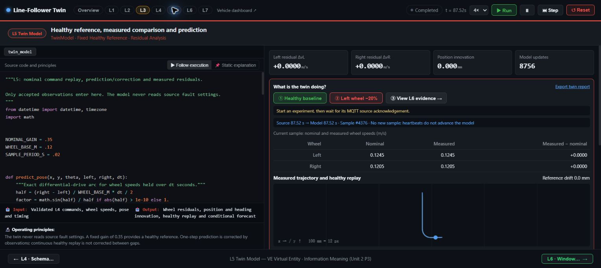

# Line-Follower Digital Twin

An educational digital twin prototype for a line-following car, with a Python web application, a live MQTT communication link, and MATLAB/Simulink reference models.

The project grew out of youth education and training activities in which students build their own line-following cars. Its aim is to help students connect visible vehicle behavior with sensor readings, control decisions and motion models.



## What the project demonstrates

- A simulated differential-drive vehicle and eight reflectance sensors, sampled every 20 ms of simulation time.
- A local MQTT 3.1.1 broker with separate telemetry, command and acknowledgement topics.
- Telemetry validation, deduplication, gap detection and data-freshness checks.
- A receiver-side healthy model that does not read injected fault settings.
- Signed wheel-speed residuals, one-step position and heading prediction, observation correction, and continuous healthy-command replay.
- A one-second conditional forecast that assumes the current motor commands remain unchanged.
- Window-based diagnostic evidence, candidate PID comparisons, acknowledged commands, and CSV/JSON exports.
- An English vehicle dashboard and a separate seven-layer teaching dashboard with source-code views.

The current physical asset is simulated in software. The MQTT link is operational; a connection to student-built physical cars is future work. Clearing an injected simulation fault starts a new comparison experiment and does not represent a physical motor repair.

## Quick start: Python web application

Use Python 3.12 or 3.13. MATLAB is not required for the Python application. No external MQTT service or cloud account is needed: the application starts its local broker automatically.

### Windows PowerShell

```powershell
git clone https://github.com/LisaZhao0709/line-follower-digital-twin.git
cd line-follower-digital-twin/web_app
python -m venv .venv
& '.venv/Scripts/python.exe' -m pip install -r requirements.txt
& '.venv/Scripts/python.exe' -B app.py --open-browser
```

After creating the environment, `web_app/启动网页.cmd` can also start the application.

### Linux or macOS

```bash
git clone https://github.com/LisaZhao0709/line-follower-digital-twin.git
cd line-follower-digital-twin/web_app
python3 -m venv .venv
.venv/bin/python -m pip install -r requirements.txt
.venv/bin/python -B app.py
```

Open these addresses on the machine running the application:

- Vehicle dashboard: <http://127.0.0.1:8765/>
- Seven-layer walkthrough: <http://127.0.0.1:8765/showcase#home>
- Model comparison experiments: <http://127.0.0.1:8765/showcase#layer/5>

The local broker uses port `18884`. Stop the application with **Ctrl+C in the terminal that started it**; closing a browser tab does not stop the service. If the ports are already in use, run `app.py --port 8766 --broker-port 18886`.

## Suggested demonstration

1. Open L5 and select **Healthy baseline**. Confirm the source acknowledgement and increasing model-update count. Near-zero residuals indicate agreement with the healthy reference.
2. Select **Left wheel −20%**. A new experiment starts with the same default PID, ideal sensor environment and seed. The left residual becomes negative while the right residual remains near zero.
3. Compare the blue measured trajectory with the orange healthy replay. The purple curve assumes constant current commands; it is not a guaranteed future path.
4. Pause and step the source. Heartbeats for an unchanged sample do not advance the model.
5. Interrupt telemetry upload. Source time can advance while the twin remains frozen. Restore upload to realign the reference; missing intervals are not evaluated as valid prediction errors.
6. Inspect L6 evidence and export received CSV or the analysis JSON.

## Architecture

| Layer | Source directory | Responsibility |
| --- | --- | --- |
| L1 Physical | `web_app/layers/l1_physical/` | Track, chassis, onboard control and safety |
| L2 Acquisition | `web_app/layers/l2_acquisition/` | Sensors, source state and telemetry packaging |
| L3 Communication | `web_app/layers/l3_communication/` | MQTT clients and local broker lifecycle |
| L4 Data management | `web_app/layers/l4_data_management/` | Validation, ordering, history and export |
| L5 Twin model | `web_app/layers/l5_twin_model/` | Healthy references, prediction, correction and residuals |
| L6 Services and feedback | `web_app/layers/l6_service_feedback/` | Diagnostic evidence and command lifecycle |
| L7 Application | `web_app/layers/l7_application/` | Web API, dashboards and interaction |

`web_app/runtime.py` coordinates component lifecycle, source scheduling and the flow of accepted observations. Top-level modules such as `model.py` and `twin_model.py` remain compatibility exports.

## Tests

From `web_app/`, use the same Python environment that runs the application:

```powershell
& '.venv/Scripts/python.exe' -B -m unittest test_components test_system -v
```

On Linux or macOS, replace the interpreter with `.venv/bin/python`.

The suite contains 19 tests covering component contracts, healthy/fault comparisons, heartbeats, gaps, safety stops, CSV/report output, real local MQTT exchange and numerical comparison with a frozen MATLAB trace. The reference trace is included in `full_project/results/week5_20261005_005312/`. The GitHub Actions workflow runs this suite on standard hosted runners.

## MATLAB/Simulink route

The MATLAB/Simulink model is a separate local execution route and requires MATLAB with Simulink. The original validation used MATLAB R2025b.

- Complete project: change the MATLAB working directory to `full_project/` and run `START_PROJECT`.
- Open the editable model: run `OPEN_MODEL`.
- Regenerate the week 5–8 experiments: run `RUN_ALL_WEEKS`.
- Earlier baseline: change to `weeks1_4/` and run `START_WEEKS1_4`.

Source scripts, kernels, maps, `.slx` models and the default saved experiments needed for startup are included. Large historical experiment dumps, model backups, generated build caches and duplicate ZIP bundles are not included. Tools that audit those historical deliveries require the original archived evidence or regenerated experiments.

## Video and submission documents

- [Project and video submission description](docs/PROJECT_SUBMISSION.md)
- [Full video recording guide](展示/数字孪生全流程操作讲解与视频录制指南.md): Chinese operating instructions with English narration, including the youth-education background.
- [Architecture and source walkthrough](web_app/七层架构与视频讲解指南.md)
- [L5 explanation and experiment guide](web_app/第五层检查与演示说明.md)
- [Detailed project source guide](项目架构与代码导读.md)

## Online execution and cost

This repository is public, but GitHub does not automatically host the Python application. [GitHub Pages serves static HTML, CSS and JavaScript](https://docs.github.com/en/pages/getting-started-with-github-pages/what-is-github-pages); it cannot run the Flask process and local MQTT broker required by this application.

GitHub Codespaces provides a separate cloud development environment, with [included personal-account quotas and potential charges beyond those quotas](https://docs.github.com/en/billing/concepts/product-billing/github-codespaces). No Codespace, paid hosting, external cloud environment or billing configuration has been created for this project. Use the local quick-start instructions above for the complete experience.

## Interpretation limits

Diagnostic thresholds are explicit teaching rules. A wheel-speed residual supports a drive-response mismatch finding, but does not identify a particular failed mechanical or electrical component. Physical hardware deployment requires acquisition adapters, measured geometry, motor/sensor calibration and validation against actual observations.
