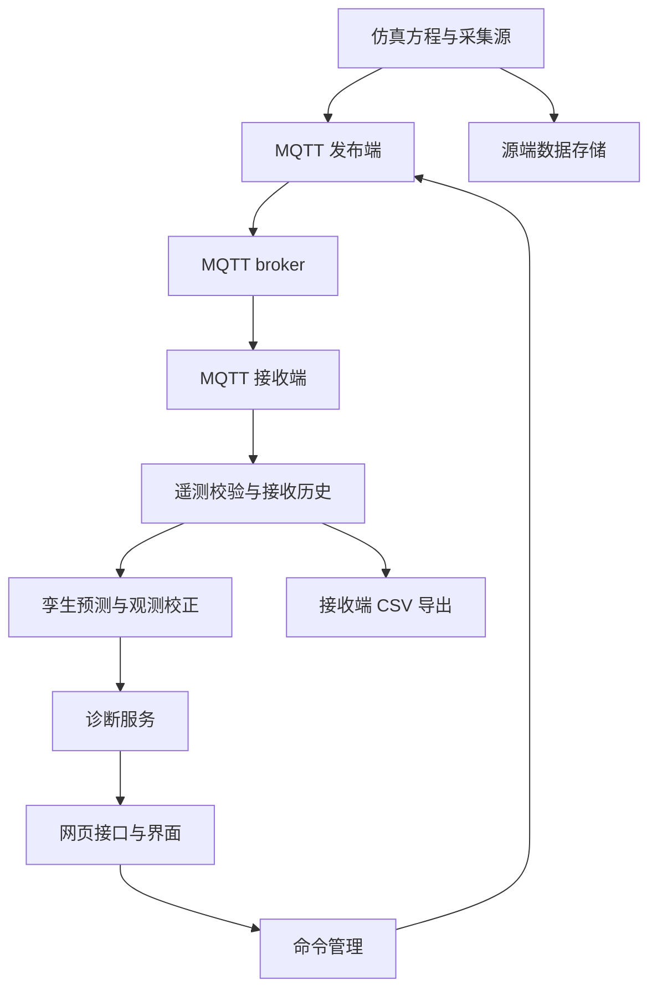

# 模块职责与输入输出

更新日期：2026-11-08。拆分范围是当前 Python 网页应用。MATLAB/Simulink 工程保留原有结构。

## 1. 每个部分负责什么

| 部分 | 文件与入口 | 输入 | 处理 | 输出 |
| --- | --- | --- | --- | --- |
| 仿真方程 | `model.py`：`Config`、`Track`、`Simulator.step()` | 地图、几何参数、PID 参数、环境种子与扰动 | 8 路灰度、PID、左右轮速、差速运动和保护判断 | 一帧仿真观测与是否结束；20 ms 仿真步长 |
| 采集源运行状态 | `source.py`：`SimulationSource.execute()/advance()` | 运行、暂停、继续、单步、复位动作 | 管理源端实验编号、仿真器、采样缓存与运行状态 | 最新源帧、当前实验采样、完成待保存标记 |
| MQTT 通信 | `mqtt_transport.py`：`MqttTransport` | 会话、端口、待发送字典与接收回调 | 连接、订阅、JSON 编解码、发布与通信开关 | 解码消息、连接状态、发送计数；不计算孪生 |
| MQTT broker | `broker.py`：`serve()`；`broker_process.py`：`BrokerProcess` | 本机端口 | 代理转发；启动、检查和关闭独立代理进程 | 可通信的 MQTT 服务及进程资源 |
| 数据接入与质量 | `telemetry.py`：`TelemetryReceiver.accept()/freshness()` | 解码后的遥测与会话标识 | 字段校验、顺序检查、重复处理、缺口检查、接收历史和数据年龄 | 接受／重复／异常结果、有效历史、质量状态与计数 |
| 孪生模型 | `twin_model.py`：`TwinModel.update()/reset()` | 通过接入校验的遥测、上次同步状态 | 标称轮速、位姿预测、新观测校正、轮速残差 | 孪生状态、预测位置、校正量，以及加入观测的 `expected_*` 和 `residual_mps` |
| 命令管理 | `commands.py`：`CommandService` | 用户动作、MQTT 到达的命令、执行回执 | 配置检查、命令 ID、队列、重复执行抑制、回执匹配与超时 | 待发布命令、执行回执、面向用户的命令状态 |
| 数据存储与导出 | `storage.py`：`ExperimentStore.save_run()`、`received_csv()` | 实验编号、配置、源端采样或接收采样 | 按固定列结构保存、生成 CSV 与实验摘要 | `source.csv`、`summary.json`、接收端 CSV 下载文本 |
| 诊断服务 | `analysis.py`：`analyze()` | 有效历史、最新观测、数据年龄 | 窗口指标、驱动响应、感知参考差异、控制表现和建议 | 指标、证据、规则、建议与适用范围 |
| 网页接口 | `app.py`：`create_app()/main()` | HTTP 请求、启动参数 | 注册路由、组织响应、启动与关闭整体应用 | HTTP JSON、下载响应与静态页面 |
| 用户界面 | `static/index.html`、`style.css`、`app.js` | API 响应与用户操作 | 展示、绘图、表单、发起操作 | 用户能理解的车辆状态、曲线、诊断和操作反馈 |
| 运行调度 | `runtime.py`：`Runtime` | 各组件实例、用户动作与消息回调 | 加锁、线程调度、传递组件输出、拼装网页状态 | 一个集成运行的原型；组件之间的调用关系 |

## 2. 仿真源与孪生模型的边界

`Simulator` 生成代表小车的观测，属于数据源一侧。`TwinModel` 只使用接收端接受的遥测和自身上次状态，不能读取 `Simulator` 对象或源端故障开关。即使遥测带有实验配置，孪生预测也不使用其中的电机故障系数。

例如源端左电机响应降至 80%，源端会报告较低轮速。接收端仍使用独立的健康参考 `0.35 × uL`，据此计算残差。分析服务根据观测估计响应比例，不按故障开关直接给出结论。

`TwinModel.update()` 会在接受的观测字典中添加模型结果。`TelemetryReceiver.history` 保留该字典，因此诊断与导出能够读取这些结果。接入校验和模型更新由 `Runtime.receive()` 在同一把锁内依次执行。

## 3. 一条数据怎样经过所有组件

图中命令同样经过 broker：观察端发布 `command`，源端订阅后入队，调度线程执行。源端发布 `ack`，观察端收到后更新命令状态。三个主题分别为 `telemetry`、`command`、`ack`，共享本次会话前缀；QoS 1，消息不保留。

## 4. 重要状态现在去哪里找

| 原先集中在运行时的内容 | 现在的唯一责任对象 |
| --- | --- |
| 仿真器、最新源帧、完整源采样、实验编号、源端运行状态 | `runtime.asset.sim/frame/frames/run_id/state` |
| 最新有效遥测、接收历史、序号、缺口、重复与拒收计数 | `runtime.receiver` |
| 孪生状态及模型更新计数 | `runtime.twin_model.state/updates` |
| MQTT 客户端、主题、发送计数与上传／回传开关 | `runtime.mqtt` |
| 当前命令、待执行队列、已执行 ID 与回执 | `runtime.commands` |
| 存储根目录、本进程已完成实验摘要 | `runtime.store` |
| 锁、调度线程、事件日志和模块连接 | `runtime` |

网页的 `/api/state` 字段和原启动方式保持一致。内部 Python 属性已迁到所属对象，测试也改为访问这些责任对象。

## 5. 哪些改动应去哪个文件

- 改灰度生成、PID 方程、运动学：`model.py`。
- 改源端运行／暂停／复位的执行：`source.py`。
- 改 MQTT 客户端、主题或 QoS：`mqtt_transport.py`；改 broker 配置：`broker.py`。
- 改接收格式校验、序号规则或数据新鲜程度：`telemetry.py`。
- 改接收端预测、校正或健康参考：`twin_model.py`。诊断使用该模块公开的健康参考系数。
- 改命令去重、回执或超时：`commands.py`。
- 改实验落盘和 CSV 列结构：`storage.py`。
- 改异常判断与建议：`analysis.py`。
- 改 API：`app.py`；改界面：`static/`。
- 改模块调用顺序和调度：`runtime.py`。

## 6. 保存范围与验证状态

本次拆分保留原有保存时机与数据列：完圈或保护停车后保存源端记录，接收端 CSV 可随时导出。实验摘要列表仍属于当前进程，重启后自动重新读取旧实验的功能未在本次加入。

2026-11-08 验证结果：14 项数值、诊断和模块测试通过；真实 MQTT 集成测试在拆分前后均因当前执行环境的本机 TCP 连接权限而无法完成。完整测试共 15 项，不能据此记为全部通过。详见 [拆分验证记录](REFACTOR_NOTES.md)。
