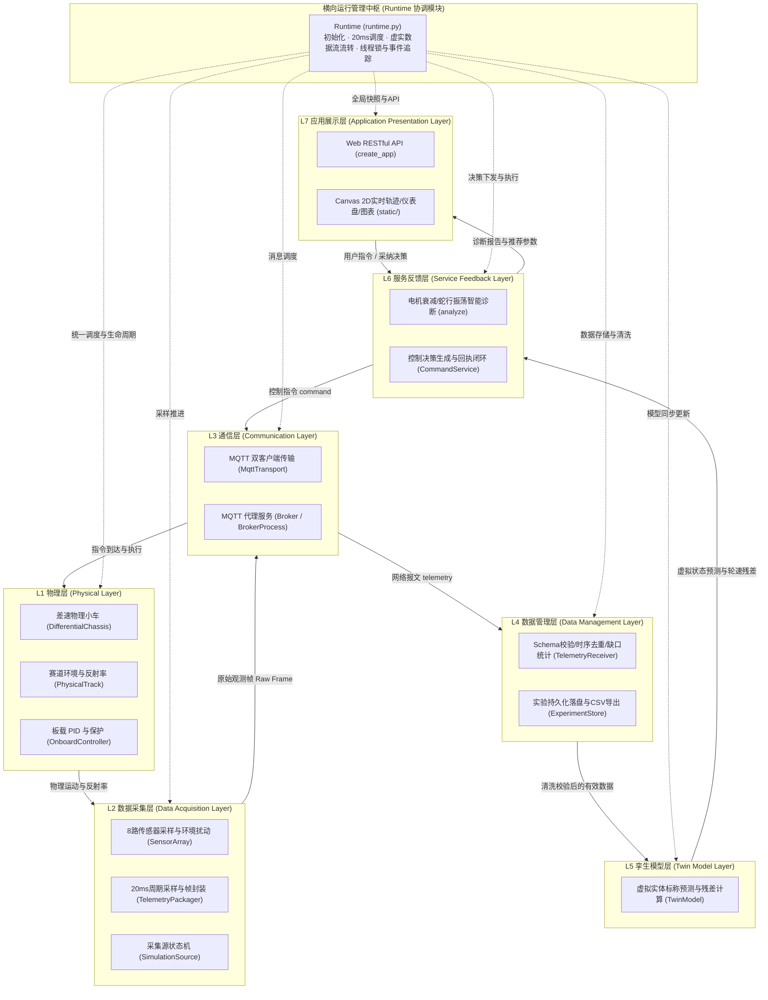

# 循迹小车数字孪生系统：七层架构与视频讲解指南

本指南保留中文操作说明，并提供英文口播。专门为您录制**架构讲解与分工演示视频**设计。项目已完整解耦为清晰的 `layers/` 七层物理目录结构，并保留了 `runtime.py` 作为横向协调中枢。

---

## 一、架构全景概览图



---

## 二、七层架构与代码位置对照表

| 层级 | 对应代码目录 | 核心任务 | 主要输入 | 核心处理类 / 函数 | 主要输出 |
| :--- | :--- | :--- | :--- | :--- | :--- |
| **L1 物理层** | `layers/l1_physical/` | 物理建模、状态计算、执行控制 | 控制器输出 $u_L, u_R$、赛道地图 | `DifferentialChassis`<br>`PhysicalTrack`<br>`OnboardController` | 物理状态 ($x, y, \theta, v_L, v_R$) |
| **L2 数据采集层** | `layers/l2_acquisition/` | 数据获取、采样、时间戳、封装 | 物理小车位姿、赛道地面反射率 | `SensorArray`<br>`TelemetryPackager`<br>`SimulationSource` | 原始观测数据帧 (`Raw Telemetry Frame`) |
| **L3 通信层** | `layers/l3_communication/` | MQTT 配置、消息发送与接收 | 原始观测帧、控制决策指令 | `MqttTransport`<br>`BrokerProcess`<br>`serve()` | 结构化通信消息 (JSON 报文) |
| **L4 数据管理层** | `layers/l4_data_management/` | 数据校验、清洗、去重、存储 | L3 接收的 MQTT JSON 报文 | `validate_observation`<br>`TelemetryReceiver`<br>`ExperimentStore` | 有效数据流、历史记录、CSV/JSON 文件 |
| **L5 孪生模型层** | `layers/l5_twin_model/` | 状态更新、模型预测、偏差计算、同步修正 | L4 校验合格的遥测数据 | `TwinModel` (`NOMINAL_GAIN=0.35`, `WHEEL_BASE=0.12`) | 虚拟状态、标称期望轮速、轮速残差、位姿创新度 |
| **L6 服务反馈层** | `layers/l6_service_feedback/` | 状态监测、分析、预测、控制决策 | 历史时域序列、L5 轮速残差与偏差 | `analyze()`<br>`CommandService` | 诊断报告、调优建议、控制决策指令 |
| **L7 应用展示层** | `layers/l7_application/` | 可视化、交互、实验展示 | Runtime 全局状态快照 (`snapshot`) | `create_app()`<br>`static/index.html`<br>`static/app.js` | Web 界面、Canvas 2D 实时轨迹、时域曲线 |
| **横向运行协调** | `runtime.py` | 统一初始化、线程调度、状态流转 | 各层组件实例、外部事件 | `Runtime` | 驱动全系统 20ms 节拍运转的集成数字孪生应用 |

---

## 三、视频讲解逐层录制脚本文案（照着读即可）

### 开场白：从青少年制作巡线小车引出项目（约2分钟）

**中文操作提示**：先讲本人从事青少年教育培训、让学生亲手制作巡线小车的经历，再引出“帮助学生理解小车如何工作”的教育目标。如有现成制作素材，可先展示；随后切到七层总览。以下英文口播区分真实的教学背景与尚处于原型阶段的数字孪生系统。

> Hello everyone. The idea for this project comes from my work in education and training for young people. In that setting, I ask students to build their own line-following cars. It is a hands-on activity that connects something they make themselves with something they can see moving along a track.
>
> For me, the educational value goes beyond getting the car to follow a line. I want students to understand how their creation works. What do the sensors detect? How does the controller turn those readings into motor commands? And how do the two wheels make the car change direction?
>
> Watching the car move gives students one part of the picture. A digital twin can make the processes behind that movement visible as well. This led to the idea of a teaching tool where students could connect the behavior of a car with sensor readings, control decisions and a model of its motion. They could change a setting, observe the result and explain the relationship between the two.
>
> That educational goal is the motivation behind this prototype. The current vehicle is simulated in software, while the MQTT broker and its clients provide a live communication link. Connecting the system to the cars that students build is a future step, rather than a feature already completed here.
>
> The system is organized into seven layers, from the vehicle and data acquisition to communication, the twin model and feedback services. I will now walk through these layers and show how each one could support that learning process.

---

### 第 1 幕：L1 物理层（打开 `layers/l1_physical/`）
- **屏幕展示**：展开 VS Code 目录树中的 `layers/l1_physical/`，打开 `physical_car.py` 与 `track.py`。
- **讲解词**：
> Layer one represents the physical side of this simulation. It defines the track, the differential-drive chassis and the onboard control and safety logic.
>
> The nominal motor gain is zero point three five metres per second per unit command, and the wheel separation is twelve centimetres. Left and right wheel speeds determine the forward velocity and turning rate.
>
> The pose update uses the exact circular arc for wheel speeds held constant during one sampling interval. This avoids the Euler integration error for that interval. It does not mean that the model includes every physical effect. Motor inertia, tyre slip and battery dynamics would require additional models and measurements.
>
> On the right, we can see position, heading and wheel speed change as the simulated car moves along the track.

---

### 第 2 幕：L2 数据采集层（打开 `layers/l2_acquisition/`）
- **屏幕展示**：打开 `sensors.py` 和 `telemetry_packager.py`。
- **讲解词**：
> Layer two turns the physical state into observations. Eight reflectance sensors are positioned across the front of the vehicle. Each sensor samples the track map at its current world position.
>
> The simulation can add changes in lighting, shadows, sensor position and measurement noise. A threshold converts sensor strengths into binary line detections. These observations are then combined with the pose, wheel speeds and controller signals in a telemetry frame.
>
> Each sample carries simulation time and a sample index. The transport adds the session and message sequence information before publication. The sampling period is twenty milliseconds, or fifty samples per simulation second.
>
> The sensor array on the right lets us connect the map geometry with the signals used by the controller. These are simulated sensor readings, rather than measurements from a connected physical sensor board.

---

### 第 3 幕：L3 通信层（打开 `layers/l3_communication/`）
- **屏幕展示**：打开 `mqtt_transport.py`。
- **讲解词**：
> Layer three connects the source and the receiver through a local MQTT three point one point one broker. Telemetry, commands and acknowledgements use separate topics under the same session prefix.
>
> QoS one provides at-least-once delivery semantics, so duplicate messages remain possible. The next layer must handle them. The field inspector shows selected values from the received message, including its sequence, simulation time, wheel speeds and sensor array.
>
> I will now interrupt telemetry upload. The source can continue moving, but the receiver no longer gets new observations. Its model must retain the last known state. After one point two seconds without a valid message, the data is marked stale.
>
> Restoring upload delivers new observations and exposes the missing interval as a gap. The command channel can be interrupted separately. A submitted request is not proof of execution: the source acknowledgement is what confirms that a command was applied.

---

### 第 4 幕：L4 数据管理层（打开 `layers/l4_data_management/`）
- **屏幕展示**：打开 `validator.py` 和 `storage.py`。
- **讲解词**：
> Layer four checks whether a received observation is usable. It validates the session, numeric ranges, sensor array lengths, sequence order and simulation time.
>
> A duplicate message must not become a new measurement or advance the twin again. Missing sample indices are recorded as observation gaps. Data freshness is tracked separately: a new valid message can make the connection fresh even though earlier samples are missing.
>
> These checks provide the accepted observation history used by the model and diagnostics. Completed experiments save their source records. We can export the received observations, together with model results, as a separate CSV file.
>
> Keeping source records and received records distinct helps us see what the asset produced and what the digital side actually observed.

---

### 第 5 幕：L5 孪生模型层 · 可验证的预测与实测对照（约3分钟）

### 操作与观察

1. 点击 L5，先点“① Healthy baseline”。等待“Applied at source”和新的实验编号。
2. 指向模型更新次数、轮速表与蓝橙轨迹：计数持续增加，两轨迹重合，残差接近零。零残差是健康状态的正确结果。
3. 点“② Left wheel −20%”。同一初态、默认 PID、理想灰度与固定种子下，只改变源端左轮响应。左轮残差为负，右轮约零，蓝橙轨迹逐渐分离。模型不读取故障设置。
4. 看毫米级单步创新度和航向校正：预测用上帧指令，当前孪生状态随后直接校正到观测。橙色参考只回放健康指令，连续期间不做位置校正。
5. 暂停后确认计数不再增长；按单步增加一个样本。紫色虚线是“保持当前指令一秒”的条件预测，不是实际 PID 必然经过的未来路线。
6. 再运行，暂停遥测上传。源端时间继续走，模型时间冻结，超过1.2秒标为过期。恢复后参考重新对齐，缺失期间不连线、不评估创新度。
7. 点“③ View L6 evidence”，核对持续窗口的左侧响应比例约80%、右侧约100%，再导出 CSV 或报告。

### 口播

> Layer five provides a healthy model that we can compare with the received observations. It does not read the source fault settings. Its nominal wheel speed is always zero point three five multiplied by the corresponding motor command.
>
> First, I will start the healthy baseline. The update count increases while the measured trajectory and healthy reference overlap. Both wheel-speed residuals are close to zero. Zero residual is the correct result when the simulated asset agrees with the nominal model; it does not mean that the model is inactive.
>
> Next, I will start the left-wheel reduction experiment. This creates a new run from the same initial state, with the same PID settings, ideal sensor environment and seed. Only the simulated left-wheel response is reduced by twenty percent. The left measured speed is now below its nominal value, producing a negative residual. The right-wheel residual remains close to zero.
>
> There are two different position comparisons. The one-step prediction uses the previous commands and is corrected by each new pose observation. Its position innovation is shown in millimetres. The orange healthy replay starts from the initial observation and continues without position correction between consecutive samples. Its growing separation from the blue measured trajectory demonstrates persistent model mismatch.
>
> The purple dashed curve is a conditional forecast: it assumes that the current commands remain constant for one second. The actual PID will update those commands, so this is not a guaranteed future route.
>
> When upload is interrupted, the twin retains its last observation. After recovery, missing commands cannot be reconstructed, so the reference is realigned and the missing interval is not treated as a valid prediction error. Layer six then uses the healthy reference and residuals as evidence for its diagnostic window.

详细数值、公式、边界与源码见 [第五层检查与演示说明](第五层检查与演示说明.md)。

---

### 第 6 幕：L6 服务反馈层 · 依据连续观测形成闭环（约2分钟）

### 操作与观察

1. 从 L5 左轮衰减实验进入 L6。连续样本充分后才应出现 `drive_left_low`，不是勾选故障框就判定异常。
2. 检查响应比例、有符号残差和诊断依据。最近1秒至少20个连续样本、跨度至少0.38秒，源时间达到0.6秒；驱动诊断还需要至少15个有效驱动样本。
3. 点“Clear simulated fault and rerun”，等待源端回执。它将仿真源系数恢复为1.0并从起点新建实验，不是在线维修或补偿真实电机。
4. PID 可以手动设置或选择预设。建议来自当前规则与窗口数据，是待验证的候选配置；点击采纳会新建实验，不能保证最优或必然完成一圈。
5. 提交 HTTP 请求只代表请求被接受；查看源端执行回执，再用返回的实验编号和遥测确认新参数。

### 口播

> Layer six turns observations into evidence and possible next steps. It examines a recent window rather than diagnosing a fault from a single speed spike.
>
> In this experiment, the left response ratio is about eighty percent, while the right side remains close to one hundred percent. Together with the signed residual, this supports a finding of reduced drive response on the left. It does not identify a specific failed electrical or mechanical component.
>
> The Clear simulated fault and rerun button restores the simulation coefficient and starts a new comparison. It is not a physical motor repair or an online calibration procedure.
>
> For control problems, the service can propose candidate PID settings using explicit rules and the current observations. These settings still need a comparison run. After sending a command, we wait for the source acknowledgement and check the new run identifier and telemetry. We then compare tracking error, saturation and lap completion instead of assuming that a suggested setting must be better.

---

### 第 7 幕：L7 应用展示层（打开 `layers/l7_application/`，并在浏览器中打开页面）
- **屏幕展示**：展示 `static/index.html` 和 `app.js`，切换到浏览器网页大屏。
- **讲解词**：
> Layer seven brings the system together in an interactive dashboard. The experiment lab shows the track, sensor observations, controller terms and diagnostic findings. The Data and twin view makes the source clock, message counts, model updates and communication channels visible. Completed runs appear in Experiment records, and received data can be exported for later analysis.
>
> The Runtime module coordinates these layers. It assembles the components, schedules source sampling, passes accepted observations into the model, manages commands and provides consistent snapshots to the interface.
>
> The complete workflow is observation, communication, validation, model comparison, diagnosis and acknowledged feedback. Each step has an observable input and output. The current result is a tested simulation-based prototype with a live MQTT link. Connecting a physical vehicle would be the next stage, requiring real acquisition hardware, measured parameters and validation against physical observations.

---

### 总结：Runtime 横向运行管理（打开根目录下的 `runtime.py`）
- **屏幕展示**：打开 `web_app/runtime.py`。
- **讲解词**：
> Runtime is the horizontal coordinator of the seven-layer application. It assembles the components, advances the source clock, schedules message processing and protects shared state with a lock. Accepted observations update the twin, service results become interface snapshots, and commands return to the source through MQTT. The application is organized into separate responsibilities while Runtime manages their lifecycle and data flow.

---

## 四、启动与自动化测试验证

本重构保持了 **100% 的向后兼容性**，根目录下的启动脚本与测试完全不受影响：

1. **一键启动 Web 界面**：
   - 双击运行：`line_follower_twin/web_app/启动网页.cmd`
   - 或终端运行：`python app.py --open-browser`
2. **离线组件单元测试（11项）**：
   ```powershell
   python -m unittest test_components.py
   ```
3. **真实 MQTT 全链路集成测试（8项，含数值与真实通信回归）**：
   ```powershell
   python -m unittest test_system.py
   ```

