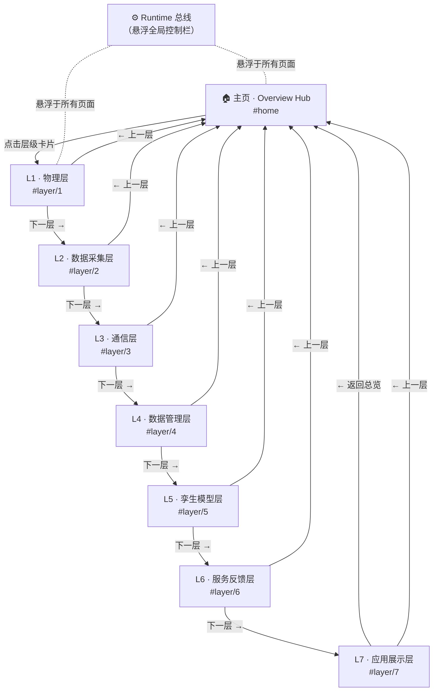

# 循迹小车数字孪生 · 可视化架构展示系统
## 技术 & 功能设计方案 v1.0

> **用途：** 供作者审核与确认，通过后即启动实现阶段。  
> **约束：** 纯 HTML5 + CSS + 原生 JS，无构建工具，零新 Python 依赖，双击 `启动网页.cmd` 即可运行。

---

## 一、整体架构思路

### 1.1 核心理念：「教学剧场」模型

本系统不是普通的监控大屏，而是一个**以视频讲解为核心场景**设计的「教学剧场」。

每一页就是舞台上的一幕戏：
- **主角**：当前层级的代码逻辑（左侧代码剧本）
- **配角**：实时运行数据（右侧实况面板）
- **导演**：观看者（你）——控制运行、暂停、逐帧

整个系统是一个 **SPA（单页应用）**，使用 `hash` 路由（`#home`、`#layer/1`...`#layer/7`），页面切换时：
- ✅ 后端 `Runtime` 持续运行，不中断
- ✅ 轮询保活，状态不丢失
- ✅ 视图切换仅替换 DOM 内容，不刷新页面

---

### 1.2 文件结构（新增，不改动现有文件）

```
web_app/
├── static/
│   ├── index.html          ← 现有文件（原始运行看板，保留不动）
│   ├── app.js              ← 现有文件（原始运行逻辑，保留不动）
│   ├── style.css           ← 现有文件（保留不动）
│   │
│   ├── showcase.html       ← 🆕 展示系统入口（独立 HTML）
│   ├── showcase.css        ← 🆕 展示系统专属样式
│   └── showcase.js         ← 🆕 展示系统路由 + 数据轮询 + 渲染引擎
│
└── layers/
    └── l7_application/
        └── web_api.py      ← 仅补充 2 条路由（见 §4.1），其余不动
```

> [!IMPORTANT]
> `showcase.html` 与 `index.html` 完全独立，互不干扰。访问路径：`http://127.0.0.1:8765/showcase`

---

## 二、页面结构总览



---

## 三、各页面详细设计

---

### 3.1 主页 (Overview Hub) — `#home`

#### 布局草图

```
┌─────────────────────────────────────────────────────────┐
│  顶栏：LOGO · 系统名称                     [全局控制栏]  │
├─────────────────────────────────────────────────────────┤
│  HERO 区：项目一句话介绍 + 动态数字孪生五维徽章         │
├─────────────────────────────────────────────────────────┤
│  实时心跳条：当前仿真时间 / 层层数据流 / 质量状态        │
├────────┬────────┬────────┬────────┬────────┬────────┬───┤
│ L1卡片 │ L2卡片 │ L3卡片 │ L4卡片 │ L5卡片 │ L6卡片 │L7 │
│物理层  │数据采集│通信层  │数据管理│孪生模型│服务反馈│展示│
│[实时值]│[实时值]│[实时值]│[实时值]│[实时值]│[实时值]│[▶]│
│  → 进入│  → 进入│  → 进入│  → 进入│  → 进入│  → 进入│进入│
└────────┴────────┴────────┴────────┴────────┴────────┴───┘
│  数据流动画：L1 → L2 → L3 → L4 → L5 → L6 → L7        │
└─────────────────────────────────────────────────────────┘
```

#### 功能细节

| 区块 | 内容 | 技术实现 |
|------|------|---------|
| **HERO 标题** | "循迹小车 · 数字孪生全链路教学系统" + 2行描述 | 静态文字 |
| **五维徽章** | 🔵 PE物理实体 🟣 VE虚拟实体 🟡 DD数据 🟢 CN连接 🔴 Ss服务 | CSS flex + 闪烁动效 |
| **实时心跳条** | `仿真时间 t=12.4s` · `质量: good` · `MQTT: ✅ 已连接` | 每2s轮询 `/api/state` |
| **七层卡片** | 每张卡片显示层级编号 + 名称 + 1行关键实时值（见下表） + "→ 进入" 按钮 | 点击跳转 `#layer/N` |
| **数据流动画** | 7个节点连线，粒子从 L1 流向 L7，运行中持续流动 | CSS animation + JS控制速度 |

**七层卡片实时值映射（从 `/api/state` 读取）：**

| 层 | 卡片显示的关键实时值 | 数据字段路径 |
|---|---|---|
| L1 | `位姿 x=1.23m y=0.45m θ=12°` | `state.frame.x/y/theta` |
| L2 | `传感器 S[8] = [0,1,1,0,0,1,0,0]` | `state.frame.sensors` |
| L3 | `MQTT ↑已发送 234帧 ↓已收1条命令` | `state.mqtt.sent_count` |
| L4 | `接收 234帧 有效 231帧 缺口 1` | `state.frame.seq` + `state.quality` |
| L5 | `残差 ΔvL=0.012 ΔvR=-0.008 m/s` | `state.twin.residual_mps` |
| L6 | `健康状态: ✅ 正常` / 诊断卡数量 | `state.metrics.findings` |
| L7 | `当前视图 · 点击进入全功能看板` | 静态 |

---

### 3.2 层级详情页通用布局 — `#layer/N`

> [!NOTE]
> 所有 7 个层级页面共享同一套 HTML 模板，由 JS 路由动态填充内容。

#### 布局草图（1920×1080 或 1440×900 横屏为主）

```
┌──────────────────────────────────────────────────────────────────┐
│ 顶栏：← 总览  L1  L2  L3  L4  L5  L6  L7     [全局控制栏]      │
├──────────────────────────────────────────────────────────────────┤
│ 层级标题栏：● L1 物理层   "差速底盘动力学与板载 PID 执行控制"   │
│ 副标题：本层职责 · 核心类 · 数字孪生五维定位                     │
├─────────────────────────────┬────────────────────────────────────┤
│      左侧：代码剧场 (45%)   │      右侧：实时数据仪表盘 (55%)    │
│                             │                                    │
│  [文件选择标签页]           │  ┌──────────────────────────────┐  │
│  controller.py  physical_   │  │  核心输出数值卡（3~4个大字）  │  │
│  car.py  track.py           │  │  x=1.23m  y=0.45m  θ=12.3°  │  │
│                             │  └──────────────────────────────┘  │
│  ┌─────────────────────┐   │                                    │
│  │  代码块（Prism.js） │   │  ┌──────────────────────────────┐  │
│  │                     │   │  │  时序折线图（近100帧数据）    │  │
│  │  当前执行函数       │   │  │  横轴=仿真时间  纵轴=数值     │  │
│  │  高亮行 →           │   │  └──────────────────────────────┘  │
│  │  def step_physics() │   │                                    │
│  │      ...            │   │  ┌──────────────────────────────┐  │
│  │  ← 高亮行           │   │  │  状态/诊断/说明文字区         │  │
│  │                     │   │  │  （该层的运行状态解读）       │  │
│  └─────────────────────┘   │  └──────────────────────────────┘  │
│                             │                                    │
│  [原理卡片]                 │  ┌──────────────────────────────┐  │
│  本层工作原理简述           │  │  事件日志（最新5条 Runtime   │  │
│  （3~5行精炼文字）          │  │  event 信息，自动滚动）       │  │
│                             │  └──────────────────────────────┘  │
├─────────────────────────────┴────────────────────────────────────┤
│  底部导航：  ← 上一层 (L0=返回总览)        下一层 (L2 数据采集) → │
└──────────────────────────────────────────────────────────────────┘
```

#### 左侧代码剧场详细设计

**代码显示模式（两档切换）：**

| 模式 | 效果 | 适用场景 |
|------|------|---------|
| `📌 静止讲解` | 代码静止，当前关键函数高亮（黄色背景），观看者可手动滚动 | 视频讲解时，对着屏幕讲解代码逻辑 |
| `▶ 跟随运行` | 仿真运行中，自动滚动到「当前正在执行」的代码段，每帧用绿色边框标记活跃行 | 演示数据流动时，动态跟随 |

**各层展示的代码文件与高亮函数：**

| 层 | 主文件 | 高亮函数/代码段 | 说明 |
|---|---|---|---|
| L1 | `layers/l1_physical/physical_car.py` | `DifferentialChassis.step()` | Exact ZOH 差速积分，每20ms调用1次 |
| L1 | `layers/l1_physical/controller.py` | `OnboardController.compute()` | PID 计算 P、I、D 三项 |
| L2 | `layers/l2_acquisition/sensors.py` | `SensorArray.sample()` | 8路传感器采样 + 扰动叠加 |
| L2 | `layers/l2_acquisition/telemetry_packager.py` | `TelemetryPackager.pack()` | 帧封装，打时间戳与序号 |
| L3 | `layers/l3_communication/mqtt_transport.py` | `publish_observation()` / `subscribe()` | 双向 MQTT 收发 |
| L4 | `layers/l4_data_management/validator.py` | `validate_observation()` / `freshness()` | 校验 + 新鲜度评估 |
| L5 | `layers/l5_twin_model/twin_model.py` | `TwinModel.update()` | 标称预测 + 残差计算 |
| L6 | `layers/l6_service_feedback/diagnostics.py` | `analyze()` 中的 `motor_decay` 窗口判断 | 滑动窗口诊断 |
| L7 | `layers/l7_application/web_api.py` | `state()` → `runtime.snapshot()` | RESTful 状态聚合 |

> [!TIP]
> 代码内容在 `showcase.js` 中以 JS 字符串形式嵌入（从服务器读取对应 `.py` 文件），使用 Prism.js 语法着色（CDN inline 嵌入）。

#### 右侧实时数据仪表盘详细设计

**各层显示的核心数值卡：**

| 层 | 数值卡 1 | 数值卡 2 | 数值卡 3 | 时序图主指标 |
|---|---|---|---|---|
| L1 | `x/y 位置` (m) | `θ 航向角` (°) | `uL / uR 控制量` | `PID误差 e(t)` 折线 |
| L2 | `传感器阵列 S[8]` 8格LED | `噪声等级` | `帧序号 seq` | `传感器中心值` |
| L3 | `↑发送帧数` | `↓收到命令数` | `MQTT连接状态` | `发送频率` (帧/s) |
| L4 | `接收 / 有效 / 丢弃` | `网络缺口数` | `数据新鲜度` | `质量评分` |
| L5 | `ΔvL 轮速残差` | `ΔvR 轮速残差` | `创新度 d_m` | `残差 vs 时间` |
| L6 | `诊断状态标签` | `发现卡数量` | `推荐参数预览` | `PID误差分析` |
| L7 | `当前运行状态` | `总帧数` | `会话质量` | `综合时序曲线` |

**折线图规格：**
- 显示最近 **100 个数据点**（约 2 秒仿真时间）
- 每 **200ms** 刷新一次（从全局轮询数据分发）
- 使用原生 Canvas 2D 绘制（零依赖），背景暗色、线条亮色

---

### 3.3 全局悬浮控制栏（所有页面共享）

```
┌──[▶ 运行] [⏸ 暂停] [⏭ 单步] [↺ 重置]  速度: [1× 4× 8×]  仿真时间: 12.4s  状态: 运行中──┐
```

- **固定在顶部右侧**，宽度约 600px，始终可见
- 操作通过 `POST /api/command` 发送 `run / pause / step / reset`
- 状态指示灯：🟢 运行中 / 🟡 暂停 / ⚪ 待机 / 🔴 故障

---

### 3.4 层级页导航方式

**页面内导航策略：**

```
[ ← 上一层 ]                              [ 下一层 → ]
  L0 = 返回总览                             显示下一层名称
```

**顶部进度条导航：**

```
◉ [L1] [L2] [L3] [L4] [L5] [L6] [L7]
     ↑ 当前层（填充高亮）
```

点击任意层号可直接跳转，当前层高亮显示，已访问层显示对勾。

---

## 四、技术实现方案

### 4.1 后端：新增 2 条 Flask 路由

在 `layers/l7_application/web_api.py` 末尾追加（不改动任何现有路由）：

```python
@app.get('/showcase')
def showcase():
    """展示系统入口页"""
    return send_file(Path(static_folder) / 'showcase.html')

@app.get('/api/code/<layer_id>/<filename>')
def code_source(layer_id, filename):
    """按需返回层级源码（纯文本，供前端语法高亮）"""
    allowed_layers = {
        'l1': 'l1_physical', 'l2': 'l2_acquisition',
        'l3': 'l3_communication', 'l4': 'l4_data_management',
        'l5': 'l5_twin_model', 'l6': 'l6_service_feedback',
        'l7': 'l7_application'
    }
    if layer_id not in allowed_layers:
        return '', 404
    file_path = Path(__file__).parent.parent / allowed_layers[layer_id] / filename
    if not file_path.exists() or file_path.suffix != '.py':
        return '', 404
    return Response(file_path.read_text(encoding='utf-8'),
                    mimetype='text/plain; charset=utf-8')
```

> [!NOTE]
> 只需新增这 2 条路由，不改任何现有逻辑，所有测试保持 100% 通过。

---

### 4.2 前端架构（`showcase.js`）

```
showcase.js
├── Router          → hash 路由管理（#home / #layer/1-7）
├── Poller          → 单一全局轮询，200ms 周期，轮询 /api/state
│   └── 分发机制   → 当前激活视图注册数据回调，切换视图时自动换绑
├── CodeViewer      → 代码显示引擎（Prism.js + 滚动控制）
├── ChartEngine     → Canvas 2D 折线图（无依赖）
├── ControlBar      → 全局控制栏（run/pause/step/reset）
└── Pages
    ├── HomePage    → 主页渲染（七层卡片 + 数据流动画）
    └── LayerPage   → 层级页渲染（代码左 + 仪表盘右）
```

**单一轮询 + 视图分发策略（解决性能与状态问题）：**

```javascript
// 核心设计：只有 1 个 setInterval，所有页面共享同一份数据
const Poller = {
  interval: null,
  callback: null,  // 当前激活页面的数据处理函数
  start() {
    this.interval = setInterval(async () => {
      const data = await fetch('/api/state').then(r => r.json());
      this.callback?.(data);  // 分发给当前激活页面
    }, 200);
  },
  bind(fn) { this.callback = fn; }  // 页面切换时重新绑定
};
```

---

### 4.3 代码高亮与滚动逻辑

**静止讲解模式：**
1. 页面加载时，`GET /api/code/l1/physical_car.py` 获取源码全文
2. 用 Prism.js 渲染整块代码（Python 着色）
3. 预定义「关键段锚点」：每层有 1~2 个核心函数，页面加载后自动滚动到该位置并背景高亮

**跟随运行模式：**
1. 在 `/api/state` 返回的数据中，`source_state` 字段（`idle/running/paused`）决定是否激活跟随
2. 运行中：每次数据刷新时，根据仿真时间 `t_sim_s` 判断当前逻辑阶段，高亮对应代码行
3. 高亮规则（L1 示例）：

| 仿真时间段 | 高亮代码段 |
|-----------|-----------|
| `t % 0.02 < 0.005` | `OnboardController.compute()` — PID计算 |
| `0.005 ≤ t % 0.02 < 0.015` | `DifferentialChassis.step()` — 运动学积分 |
| `t % 0.02 >= 0.015` | `TelemetryPackager.pack()` — 帧封装（L2） |

---

### 4.4 视觉设计规范

**配色方案（暗色主题，适合视频录制）：**

```
背景色：       #0d1117  （深近黑色）
卡片背景：     #161b22  （深灰蓝）
代码区背景：   #0e1016  （更深，提升代码对比度）
强调色-蓝：    #58a6ff  （L1/L2/L3）
强调色-紫：    #bc8cff  （L4/L5）
强调色-绿：    #3fb950  （L6 健康状态）
强调色-橙：    #d29922  （L6 警告状态）
强调色-红：    #f85149  （故障/异常）
文字主色：     #e6edf3
文字辅色：     #8b949e
当前高亮行：   rgba(88,166,255,0.15) 背景 + 左侧2px蓝色边框
```

**各层专属颜色标识：**

| 层 | 专属色 | 视觉寓意 |
|---|---|---|
| L1 | `#4a9eff` 蓝 | 实体物理，稳重 |
| L2 | `#20c997` 青绿 | 传感器信号采集 |
| L3 | `#f39c12` 橙 | 通信/网络协议 |
| L4 | `#9b59b6` 紫 | 数据管理/存储 |
| L5 | `#e74c3c` 红橙 | 孪生模型预测 |
| L6 | `#2ecc71` 绿 | 诊断健康/反馈 |
| L7 | `#95a5a6` 银灰 | 应用展示/综合 |

**层级页顶部色带：** 每层页面顶部有一条 4px 的层专属色横线，视觉上快速区分当前在哪一层。

---

### 4.5 动效设计

| 动效 | 位置 | 实现 |
|------|------|------|
| 层级卡片悬停 | 主页卡片 | CSS `transform: translateY(-4px)` + 阴影增强 |
| 数据流粒子 | 主页底部连线 | Canvas 动画，粒子沿折线移动，运行中速度快，停止时慢速漂移 |
| 页面切换 | `#layer/N` 切换 | CSS `opacity 0→1`，200ms fade，不影响数据连续性 |
| 高亮行动画 | 代码区 | `background-color` 过渡动效，新高亮行闪烁一次后稳定 |
| 数值更新闪烁 | 右侧数值卡 | 新值与旧值不同时，数字短暂变亮（`#fff → 正常色`，300ms） |
| 折线图绘制 | 右侧 Canvas | 每次刷新完整重绘，使用 `requestAnimationFrame` |

---

## 五、关键设计决策（Design Decisions）

### 5.1 Q：页面切换时仿真会中断吗？
**A：绝对不会。** SPA 架构 + hash 路由，只替换 DOM 内容。后端 `Runtime` 的 20ms 守护线程独立于 Flask 请求，不受任何前端操作影响。全局 `Poller` 只是暂停 `callback` 绑定，轮询本身不停止。

### 5.2 Q：代码内容怎么获取？
**A：** 通过新增的 `/api/code/<layer>/<file>` 路由动态获取，首次加载该层页面时拉取，之后缓存在 JS 变量中。代码内容纯文本传输，前端用 Prism.js 渲染着色。

### 5.3 Q：折线图为什么不用 Chart.js？
**A：** 保持零外部依赖。原生 Canvas 2D 折线图实现简单（约 60 行 JS），且性能更好、体积更小，适合视频演示时不出现加载失败的风险。

### 5.4 Q：L7 页面如何处理？（不能重复造轮子）
**A：** L7 层级详情页的**右侧**直接嵌入一个 `<iframe src="/">` 加载原有的 `index.html`（完整运行看板）。左侧展示 `web_api.py` 的代码。这样 L7 页就是对整个系统的"终极汇聚"，用 iframe 复用原有看板，同时讲解 API 路由代码。

### 5.5 Q：移动端支持？
**A：** 本系统定位为**桌面/录屏演示专用**，最低支持 1280×720（笔记本横屏）。不为移动端做响应式适配，这样可以保证桌面布局稳定、布局精确、视频录制效果好。

### 5.6 Q：数据轮询频率如何平衡性能与流畅度？
**A：** 统一 200ms 轮询（5 fps 数据刷新），但折线图使用 `requestAnimationFrame` 以 60fps 插值补帧，视觉上流畅，实际网络请求负担轻。数值卡只在值变化时更新 DOM（脏检查），避免不必要的重排。

---

## 六、实现计划（审核通过后执行）

| 阶段 | 内容 | 预计工作量 |
|------|------|-----------|
| Phase 1 | 新增 2 条 Flask 路由 + 验证测试不受影响 | 15 分钟 |
| Phase 2 | `showcase.html` 骨架 + `showcase.css` 完整样式系统 | 1 小时 |
| Phase 3 | `showcase.js` Router + Poller + ControlBar | 45 分钟 |
| Phase 4 | 主页 (`#home`) 七层卡片 + 数据流动画 | 45 分钟 |
| Phase 5 | 层级页模板 + L5（孪生模型）第一个完整层页 | 1 小时 |
| Phase 6 | 剩余 L1~L4, L6 层页（复用模板，填充数据映射） | 1.5 小时 |
| Phase 7 | L7 层页（iframe 复用 + web_api 代码展示）| 30 分钟 |
| Phase 8 | 代码高亮 + 跟随运行模式 | 45 分钟 |
| Phase 9 | 联调 + 视频录制走查 + 细节打磨 | 1 小时 |

---

## 七、待确认清单（需作者拍板）

> [!IMPORTANT]
> 以下 5 个决策需要你确认后，才能开始实现：

1. **L7 页面方案：** 用 `<iframe>` 嵌入原有看板 ✅推荐？还是在 L7 页面右侧重新实现一个精简版 canvas？

2. **代码显示默认模式：** 默认「📌 静止讲解」（适合视频讲解停在某个函数上）还是「▶ 跟随运行」？

3. **主页数据流动画：** 要粒子流动效果（动态、吸引眼球），还是简化为静态箭头（稳重、不抢注意力）？

4. **底部导航按钮：** `← 上一层 / 下一层 →` 是固定在底部始终可见，还是只在鼠标接近页面底部时才显现（沉浸感更强）？

5. **故障注入界面：** 是否在每个层级页面加入「🧪 实验场」折叠面板？（可临时注入 `motor_left_factor=0.8` 让学生观察故障传播，非常适合教学演示）

---

*设计方案 v1.0 — 待审核 · 循迹小车数字孪生项目*
