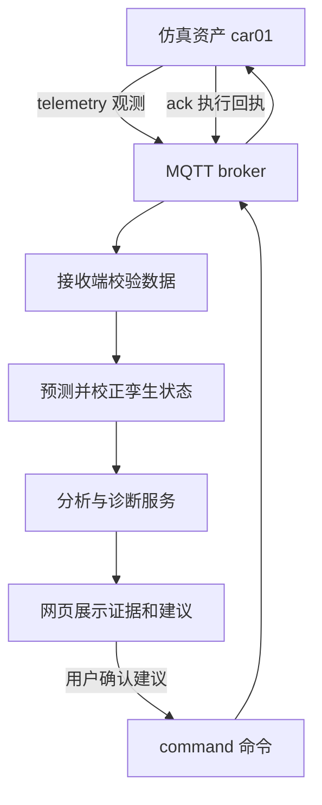

**循迹小车数字孪生项目架构与代码导读**

依据 2026-11-08 拆分后的实际源码更新。模块输入、处理、输出及源码入口另见 [web_app/MODULES.md](web_app/MODULES.md)，验证结果见 [拆分验证记录](web_app/REFACTOR_NOTES.md)。阅读重点依次为整体关系、一次实验的数据流、Python 核心文件、MATLAB 工程和历史文件。目录图中的缩进表示上下级关系，表格中的文件名对应其所在目录。

**1．先认识整个项目**

项目根目录为 `<repository>`。

当前有两条运行路线。Python 网页路线将仿真小车、MQTT、接收端模型、诊断和反馈接成一个应用；MATLAB 路线使用 Simulink 模型进行计算、验算和轨迹回放。两者共用赛道数据和主要数学方程，各自由自己的程序推进车辆状态。

| 位置 | 内容和用途 |
| --- | --- |
| `web_app/` | 当前 Python 网页应用，包含仿真资产、真实 MQTT 通信、接收端状态更新、诊断和人参与的反馈。 |
| `full_project/` | 完整 MATLAB/Simulink 工程，含 PID、随机环境、实验记录和验证工具；其 `data/` 也是网页版读取的赛道来源。 |
| `weeks1_4/` | 前四周 P/PD 教学工程，以及解析运动学修正、开环测试和历史复核。 |
| `photos/` | 预留的原始照片位置。本机当前为空。现有赛道原图保存在早期工程的 `data/track_source.png`。 |
| `report/` | 预留报告目录，本机当前为空。已生成的实验报告实际位于各工程的 `results/` 中。 |
| 顶层 `results/` | 第一阶段的图像输出位置及 MATLAB 环境记录。 |
| 顶层三个 `.m` 脚本 | 第一周的地图预处理、参数填写和坐标检查模板。 |
| 三个工程 ZIP | 2026-10-04 至 10-05 的阶段交付快照，早于 11 月新增的网页和随机环境版本。 |
| 顶层 `README.md` | 项目最早的总说明，主要介绍第一周和前四周入口。当前网页的操作说明在 `web_app/README.md`。 |

```text
line_follower_twin/
├─ web_app/                    Python 网页应用
│  ├─ 启动网页.cmd
│  ├─ app.py
│  ├─ broker.py
│  ├─ model.py
│  ├─ runtime.py             运行协调与调度
│  ├─ source.py              仿真源运行状态
│  ├─ mqtt_transport.py      MQTT 客户端与消息传输
│  ├─ broker_process.py      broker 进程管理
│  ├─ telemetry.py           接入校验与数据质量
│  ├─ twin_model.py          接收端孪生模型
│  ├─ commands.py            命令队列、去重与回执
│  ├─ storage.py             存储与 CSV 导出
│  ├─ MODULES.md             输入输出和职责边界
│  ├─ REFACTOR_NOTES.md      拆分验证记录
│  ├─ analysis.py
│  ├─ test_system.py
│  ├─ test_components.py     独立模块测试
│  ├─ requirements.txt
│  ├─ README.md
│  ├─ .gitignore
│  ├─ static/                  浏览器运行的文件
│  ├─ evidence/                人能查看的界面证据
│  ├─ results/                 完成实验的源端数据和摘要
│  ├─ runtime/                 broker 运行日志
│  ├─ .venv/                   本机 Python 环境
│  └─ __pycache__/             Python 自动生成的导入缓存
├─ full_project/               完整 MATLAB 工程
│  ├─ *.m                     启动、构建、仿真、记录、评价和验证
│  ├─ data/                    赛道图像、数据与标定说明
│  ├─ models/                  Simulink 模型及备份
│  ├─ kernels/                 模型中的 MATLAB Function 算法
│  ├─ tools/                   Python 复核、打包和证据整理工具
│  ├─ docs/                    设计与通信技术文档
│  ├─ results/                 实验及复核结果
│  └─ slprj/                   Simulink 自动生成的编译缓存
├─ weeks1_4/                   前四周工程与复核快照
├─ photos/
├─ report/
├─ results/
├─ init_line_follower.m
├─ preprocess_track.m
├─ show_track_map.m
├─ README.md
└─ 循迹小车_*.zip
```

工作区中与 `line_follower_twin` 并列的 `chapter-01-students`、`chapter-02-students`、`chapter-03-1-students` 是老师的电机示例。课程 PDF、转写、学习资料包和题库属于学习材料。当前小车网页运行时读取自己的源码和 `full_project/data/`，这些课堂工程可用于理解思路、对照实现。

**2．课程中的五个概念落在哪些代码里**

| 概念 | 在这个项目中的具体含义 | 主要代码 |
| --- | --- | --- |
| PE，物理实体 | 本次使用软件模拟的特定小车 car01，产生运动和传感器观测。 | `model.py` 的 `Simulator` 与 `source.py` 的 `SimulationSource` |
| VE，虚拟实体 | 接收端根据上一状态和标称轮速作预测，再用新观测校正状态。 | `twin_model.py` 的 `TwinModel.update()` |
| DD，孪生数据 | 位姿、灰度、命令、轮速、参数、源时间、消息编号和实验记录。 | `telemetry.py`、`storage.py` 与 `twin_model.py`，以及结果文件 |
| CN，连接 | 数据上传、命令回传与执行回执，经真实 MQTT broker 传递。 | `broker.py`、`broker_process.py`、`mqtt_transport.py` |
| Ss，服务 | 计算指标、识别异常表现、说明证据和规则、给出检查或对照建议。 | `analysis.py` |
| 应用界面 | 用户设置实验、观察状态、查看诊断、执行建议、下载数据。 | `app.py` 与 `static/` |

这里 PE 由仿真资产承担，实车遥测接入需要后续采集适配和标定。诊断逻辑使用收到的命令、轮速和灰度作判断，具体电气或机械根因需要更多观测。

**3．理解两个闭环**

小车自身的快速控制闭环每 20 ms 仿真时间执行一步。

```text
当前位置和方向
  → 在赛道图上读取8路灰度
  → 计算循迹误差
  → PID算出左右轮命令
  → 轮速改变位置和方向
  → 再次读取灰度
```

数字孪生应用在此基础上增加观测、分析和人参与的反馈。



下层 PID 决定每一步怎样转向。上层建议帮助人选择下一组实验参数。点击“按建议运行默认 PID 对照”会从同一初态启动新实验，当前没有运行中自动学习 PID 增益的算法。

**4．双击启动之后发生什么**

1. `启动网页.cmd` 切换到自己的目录，使用 `.venv/Scripts/python.exe` 执行 `app.py --open-browser`。
2. `app.py` 的 `main()` 读取端口参数。
3. `broker_process.py` 中的 `BrokerProcess` 启动独立的 `broker.py` 进程，默认监听本机 `127.0.0.1:18884`。
4. `Runtime` 读取赛道并组合 `SimulationSource`、`TelemetryReceiver`、`TwinModel`、`CommandService`、`ExperimentStore` 和 `MqttTransport`；后者建立两个 MQTT 客户端。
5. 发布端客户端订阅命令，接收端客户端订阅遥测及回执。订阅确认后，应用才完成初始化。
6. Flask 在本机 `127.0.0.1:8765` 提供网页及 HTTP 接口。浏览器准备好后自动打开。
7. 浏览器载入 HTML、CSS、JavaScript 和赛道图片。
8. `app.js` 约每 250 ms 请求一次 `/api/state`，用接收端的状态刷新图表。

运行结构中，broker 是单独的进程。Flask、小车推进线程、两个 MQTT 客户端及其网络线程由同一个 Python 应用管理。源端与接收端的职责已分开，它们的数据传递实际经过 MQTT。网页与 Python 后端之间使用 HTTP。

**5．网页目录中的每个文件**

| 文件或目录 | 作用 | 阅读重点 |
| --- | --- | --- |
| `启动网页.cmd` | Windows 启动入口，设置 UTF-8 后执行 Python。 | 最后一条 Python 启动命令。 |
| `app.py` | HTTP 服务和进程启动入口，将浏览器请求接到运行时。 | `main()`、`create_app()` 和各个路由。 |
| `broker.py` | 用 aMQTT 启动本机 MQTT 消息代理。 | `serve()`。 |
| `model.py` | 配置、地图、小车、传感器、随机环境、PID 和完圈判定。 | `Config`、`Track`、`Simulator.step()`。 |
| `runtime.py` | 协调组件调用、线程调度和加锁，拼装网页状态。 | `work()`、`receive()`、`snapshot()`。 |
| `source.py` | 管理仿真源运行状态与一次实验的源采样。 | `SimulationSource.execute()`、`advance()`。 |
| `mqtt_transport.py` | 两个 MQTT 客户端、主题、编解码、发布和通信开关。 | `MqttTransport`。 |
| `broker_process.py` | broker 进程启动、端口检查和清理。 | `BrokerProcess`。 |
| `telemetry.py` | 遥测校验、重复与缺口检查、接收历史和数据新鲜程度。 | `TelemetryReceiver.accept()`、`freshness()`。 |
| `twin_model.py` | 标称轮速、位姿预测、观测校正和残差。 | `TwinModel.update()`、`reset()`。 |
| `commands.py` | 命令 ID、队列、执行去重、回执匹配与超时。 | `CommandService`。 |
| `storage.py` | 源端实验落盘和接收 CSV 生成。 | `ExperimentStore.save_run()`、`received_csv()`。 |
| `test_components.py` | 不依赖网络的模块行为验证。 | 孪生解析参考、数据质量、存储与命令生命周期。 |
| `MODULES.md` | 每个模块的输入、处理、输出与职责边界。 | 修改定位与模型／仿真源区别。 |
| `REFACTOR_NOTES.md` | 本次拆分的变更与验证范围。 | 已通过检查及本机网络限制。 |
| `analysis.py` | 将接收到的历史数据转成指标、诊断证据和建议。 | `analyze()`。 |
| `test_system.py` | 数值回归、随机实验、诊断与真实 MQTT 测试。 | 三个测试类验证什么。 |
| `requirements.txt` | 第三方依赖及版本范围。 | Flask、NumPy、SciPy、Paho、aMQTT。 |
| `.gitignore` | 声明环境、缓存、运行日志和结果目录属于本机生成内容。 | 四类生成文件。 |
| `README.md` | 启动方式、闭环演示、规则、边界和验证命令。 | 日常使用说明。 |
| `static/index.html` | 页面结构和控件定义。 | 控件的 `id` 与页面分区。 |
| `static/style.css` | 布局、颜色、字体、诊断卡片和不同宽度下的排版。 | `.lab-grid`、`.panel`、`.diagnosis-card` 和媒体查询。 |
| `static/app.js` | 事件处理、HTTP 请求、状态更新和 Canvas 绘图。 | `command()`、`refresh()`、`update()`、绘图函数。 |
| `.venv/` | 已准备的本机 Python 环境，包含解释器入口和依赖。 | 运行环境部分，换电脑时重建。 |
| `__pycache__/` | Python 导入模块时自动生成的缓存。 | 生成文件。 |
| `runtime/broker.log` | broker 启动或运行信息。 | 启动失败时查看日志。 |
| `results/` | 完成实验后生成的源端数据和摘要。 | 每次实验自己的目录。 |
| `evidence/` | 网页截图，例如完圈、断线、弱 P、驱动诊断。 | 演示和复核证据。 |

各依赖的分工也不同。Flask 提供 HTTP 服务，NumPy 处理数组和随机数，SciPy 读取 `.mat`、插值地图和查找参考路线，Paho 实现 MQTT 客户端，aMQTT 实现 broker。

**6．`model.py` 怎样把小车算出来**

源码入口为 [model.py](<<repository>/web_app/model.py>)。

| 类或方法 | 含义 |
| --- | --- |
| `Config` | 一次实验的输入配置。可以把它理解为实验参数表。 |
| `Config.parse()` | 检查参数字段、数值范围、整数种子和布尔开关。 |
| `Track` | 保存赛道反射数据、比例、初态和完圈参考路线。 |
| `Track.__init__()` | 从共享赛道 `.mat` 中读取数据，并建立参考点查询树。 |
| `Track.sample(x,y)` | 在指定世界坐标查询灰度，使用双线性插值，图外返回零。 |
| `Simulator` | 保存并推进一辆小车的状态。 |
| `Simulator.__init__()` | 设置初始位姿、PID 内部状态、丢线计时、完圈进度和随机环境。 |
| `make_environment()` | 根据环境等级和种子生成整次实验的扰动序列。 |
| `gate()` | 用路线覆盖和起终点门判断是否完成一圈。参考路线用于验收。 |
| `step()` | 完成一个 20 ms 仿真步，返回该采样时刻的数据和结束标志。 |

`Config` 的字段定义如下。

| 字段 | 默认值 | 含义 |
| --- | --- | --- |
| `Kp`、`Ki`、`Kd` | 0.45、0.015、0.03 | PID 增益。输入范围分别为0–20、0–2、0–0.5。 |
| `environment_level` | 1 | 0为理想，1为轻度扰动，2为较强扰动。 |
| `environment_seed` | 7 | 随机种子，相同条件下复现实验。 |
| `motor_left_factor` | 1 | 左轮响应倍率。勾选教师扰动时设为0.8。 |
| `dropout` | false | 是否在1.00–1.40仿真秒遮挡传感器。 |
| `speed` | 4 | 仿真时间相对计算机经过时间的推进倍速。 |

这里有两个与“速度”相关的量。`speed=4` 表示以4倍速推进仿真时间；代码中的基础轮命令为0.35，是归一化控制量。标称轮速系数为0.35 m/s，所以左右命令都为0.35时，标称轮速约0.1225 m/s。

一次 `step()` 按下面的顺序执行。

1. 根据车身位置和方向，把车头前方的8个传感器点变换到地图坐标。
2. 读取同位姿理想灰度，再在有位置抖动的采样点读取环境灰度。
3. 加入光照、阴影、通道偏置和读数噪声，限幅到 `[0,1]`。
4. 以0.5为阈值产生8路二值结果。
5. 计算循迹误差；没有检测到黑线时暂用上次误差，并累计丢线时间。
6. 更新 P、I、D 分量，进行条件积分和积分限幅。
7. 检查丢线、越界和100秒时限，决定是否将电机命令置零。
8. 计算左右轮速，检查路线进度和起终点门。
9. 打包当前采样时刻的 `frame`。
10. 当实验仍在继续时，用精确的单周期运动增量推进到下一时刻。

主要公式可以这样读。

```text
weights = [3.5, 2.5, 1.5, 0.5, -0.5, -1.5, -2.5, -3.5]
error = sum(strength[i] × weights[i]) / (3.5 × sum(strength))
correction = P + I + D
uL = clip(0.35 - correction, 0, 1)
uR = clip(0.35 + correction, 0, 1)
vL = 0.35 × motor_left_factor × uL
vR = 0.35 × uR
v = (vL + vR) / 2
omega = (vR - vL) / 0.12
```

正误差表示黑线偏向车身左侧。左轮减速、右轮加速后，小车会向左转。I项的输出限幅为±0.20；微分使用滤波，系数对应 `Ts=0.02 s` 和时间常数0.08 s。运动更新使用单周期保持轮速下的解析增量。

完圈判定同时要求访问全部24个路线区域、累计足够进度，并沿前进方向跨过起终点门。这样能避免把起点附近的小幅摆动记成一圈。

随机环境的量级为教学设定。

| 扰动 | 轻度 | 较强 |
| --- | --- | --- |
| 光照增益变化尺度 | 0.04 | 0.12 |
| 阴影偏置尺度 | 0.08 | 0.25 |
| 位置抖动标准差 | 0.6 mm | 2 mm |
| 每路读数噪声标准差 | 0.015 | 0.06 |
| 通道固定偏置标准差 | 0.005 | 0.015 |

光照、阴影和位置抖动在时间上有相关性，分别约为2、0.8、0.08秒。Python使用自己的局部随机发生器。跨 MATLAB 和 Python 对比时，理想模型可以逐样本对照；同一个种子在两种语言中会产生各自的随机序列。

**7．`runtime.py` 怎样把各层连接起来**

`Runtime` 保留线程调度、共享锁、组件组装与网页状态拼装。预测方程、消息校验、MQTT 客户端、命令生命周期和文件格式位于各自模块。完整输入输出表见 [MODULES.md](web_app/MODULES.md)。

| 运行时入口 | 实际交给哪个组件 | 结果 |
| --- | --- | --- |
| `receive(packet)` | `receiver.accept()`，接受后按需重置并调用 `twin_model.update()` | 接收历史与孪生状态更新 |
| `command(action, values)` | `commands.request()` 通过 `mqtt.publish_command()` 发送 | 当前命令进入等待回执状态 |
| `apply_command(packet)` | `commands.execute()` 调用 `asset.execute()`，随后 `mqtt.publish_ack()` | 命令只执行一次并回传应用层结果 |
| `advance()` | `asset.advance()`；完成时调用 `store.save_run()`；再发布遥测 | 新源采样、必要的落盘与数据上传 |
| `publish()` | `mqtt.publish_observation()` | 为源帧加入消息身份并经 MQTT 发布 |
| `work()` | 调度命令处理、仿真推进和空闲心跳 | 运行线程 |
| `transport()` | `mqtt.set_channel()` | 切换上传或命令订阅 |
| `snapshot()` | 读取接收状态、调用 `analyze()`、整理展示数据 | 原有结构的 `/api/state` 响应 |
| `export_received()` | 复制接收历史后调用 `storage.received_csv()` | CSV 内容及实验编号 |
| `close()` | 停止调度线程，再关闭 MQTT 客户端 | 资源清理 |

| 状态 | 现在由谁持有 |
| --- | --- |
| 小车仿真器、源帧、源采样、实验编号、运行状态 | `runtime.asset.sim/frame/frames/run_id/state` |
| 接收端最新观测、历史、重复和缺口计数 | `runtime.receiver` |
| 孪生位姿、预测、校正量、标称轮速和更新计数 | `runtime.twin_model.state/updates` |
| 两个 MQTT 客户端、主题、发送计数、通信开关 | `runtime.mqtt` |
| 命令队列、已处理 ID 和当前命令 | `runtime.commands` |
| 保存根目录和本进程完成实验摘要 | `runtime.store` |
| 事件列表、共享锁和调度线程 | `runtime.events/lock/thread` |

区分 `asset.frame` 和 `receiver.latest` 能理解断线实验。暂停上传后，源端仍可能推进，接收端保留最后的有效样本。网页车辆轨迹使用接收端数据；源端时钟单独显示。

`TwinModel.update()` 先使用上次同步位姿及标称轮速预测当前位置，再用新观测校正状态。`prior_xy` 是校正前预测，`innovation_m` 是预测与新位置之间的距离，`state.x_m/y_m` 是校正后的状态。模型不访问源端 `Simulator`。

每个新观测样本更新模型和单帧残差，同一样本的心跳不增加模型更新次数。`snapshot()` 调用 `analyze()` 进行窗口诊断，网页轮询通常每秒约 4 次。健康轮速参考系数固定为 0.35，响应比例根据观测估计。

运行、暂停、继续、单步和复位的执行规则在 `SimulationSource.execute()`。保护停车仍对应源端停车码。

**8．消息编号和时间为什么有这么多种**

| 字段 | 定义和用途 |
| --- | --- |
| `car01` | 固定资产标识，体现在MQTT主题和界面；导出的分析报告另用 `asset` 字段保存它。 |
| `session` | 本次应用运行的会话身份，用于隔离不同应用实例。 |
| `run_id` | 一次实验的身份，运行新实验或复位会建立新编号。 |
| `seq` | 遥测消息序号，随源端的发布时机递增。暂停上传后继续递增，因此恢复后能看出缺口。 |
| `sample_index` | 车辆仿真采样编号，与20 ms步长对应。 |
| `t_sim_s` | 小车的仿真时间，等于采样编号乘以0.02。 |
| `sent_utc` | 消息发送时的 UTC 时间。 |
| `command_id` | 一条控制请求的身份。重发同一 ID 仍对应同一操作。 |
| `age_s` | 接收端使用自己的单调时钟计算的“距离最近有效消息过了多久”。 |

暂停或实验结束后，源端仍会发送心跳遥测，表示连接还在。此时消息序号可以继续增长，而采样编号保持不变。接收历史按采样编号去重，模型更新计数按新观测样本增长。

仿真时间决定物理方程的步长和丢线保护。计算机经过时间决定网页刷新和通信过期。选择8倍速会加快仿真时间推进；网页刷新仍约每250 ms一次，通信过期仍按接收端经过时间1.2秒判断。

三个 MQTT 主题如下，应用会话部分由程序自动产生。

```text
dt/car01/<本次应用会话>/telemetry
dt/car01/<本次应用会话>/command
dt/car01/<本次应用会话>/ack
```

遥测方向为小车端到接收端。命令方向相反。回执由小车端发回，说明应用层是否执行。三个主题使用 QoS 1，消息不保留；源端对命令 ID 去重。发布成功后，网页先显示等待回执，收到源端 `applied` 后才显示已执行。超时表示执行结果未知。

**9．一帧数据里主要字段是什么意思**

| 字段 | 含义 | 单位或范围 |
| --- | --- | --- |
| `x_m`、`y_m` | 小车参考点在地图中的位置。 | m |
| `theta_rad` | 小车朝向，逆时针为正。 | rad |
| `strengths` | 进入控制器的8路实际灰度观测。 | 0–1，黑线证据强时接近1 |
| `ideal_strengths` | 同位姿、名义传感器位置下的理想参考灰度。 | 0–1，仿真参考 |
| `sensors` | 灰度以0.5阈值转换的8路二值结果。 | 每路0或1 |
| `sensor_x`、`sensor_y` | 8个实际采样点的世界坐标。 | m |
| `sensor_error` | 灰度加权后的归一化循迹误差。 | 通常在−1至1之间 |
| `P`、`I`、`D` | PID三项输出。 | 与归一化命令修正量相同的量纲 |
| `uL`、`uR` | 左右轮命令。 | 0–1 |
| `left_speed_mps`、`right_speed_mps` | 仿真资产报告的左右轮速。 | m/s |
| `expected_left_mps`、`expected_right_mps` | 接收端按健康参考计算的标称轮速。 | m/s |
| `residual_mps` | 两侧轮速残差绝对值中的较大者。 | m/s |
| `stop_reason` | 源端保护或时限状态。 | 0运行，1丢线，2越界，4时限 |
| `source_state` | 软件运行状态。 | idle、running、paused、completed |
| `completed_lap`、`lap_time_s` | 是否完圈及插值圈时。 | 布尔值、s；未完圈为null |
| `light_gain`、`shadow_bias` | 本采样对应的光照增益与阴影偏置。 | 灰度模型参数 |
| `lateral_jitter_m` | 本采样对应的侧向位置抖动。 | m |
| `config` | 该条观测对应的源端实际实验参数。 | 参数对象 |
| `gap_before` | 接收端发现此帧前存在缺失采样。 | 布尔值 |

`expected_*`、`residual_mps` 和 `gap_before` 是接收端加工出的字段。`snapshot()` 另外返回 `metrics`、`twin`、`quality`、`mqtt`、`command`、`events` 和 `records`，供网页使用。

**10．`analysis.py` 怎样给出分析和建议**

源码入口为 [analysis.py](<<repository>/web_app/analysis.py>)。

`analyze(history, frame, age_s)` 接受接收历史、最后有效帧和数据年龄，返回指标及诊断结果。`finding()` 把一个判断整理成统一格式。

```text
code        便于程序判断的编号
title       人能读懂的结论
evidence    实际计算出的数值证据
rule        触发该判断的规则
advice      下一步操作建议
scope       证据能支持到什么程度
severity    提示级别
```

指标的定义如下。

| 指标 | 怎样理解 |
| --- | --- |
| MAE | 有效检测样本的误差绝对值平均数，表示平均偏离程度。 |
| RMS | 误差平方平均后开方，对较大误差更敏感。 |
| 过零频率 | 误差在一定幅度之外反复换符号的次数，帮助观察左右摆动。 |
| 饱和比例 | 可运行样本中，左右命令达到0或1的比例。 |
| 灰度 RMSE | 实际灰度和同位姿理想参考的差异量。 |
| 二值差异比例 | 实际二值结果与理想参考二值结果不同的比例。 |
| 驱动响应比例 | 在有足够驱动命令的样本中，观测轮速对标称轮速的最小二乘比例。 |
| 有符号轮速残差 | 观测减标称。负值表示低于预期，正值表示高于预期。 |

分析使用最近1秒窗口。达到至少20个样本、跨度不少于0.38秒、源时间达到0.6秒，并在窗口内部没有已知缺失区段后，开始持续异常判断。1秒包含首尾采样点时可能有51个样本。

| 条件 | 当前教学规则 | 含义 |
| --- | --- | --- |
| 数据过期 | 超过1.2秒接收端经过时间没有有效新消息。 | 暂停当前诊断及参数建议。 |
| 某侧驱动偏差 | 命令≥0.1的有效驱动样本至少15个，响应比例超出85%–115%，且有符号平均残差绝对值>0.005 m/s。 | 指出哪一侧命令—轮速关系偏离参考。 |
| 灰度参考偏差 | 灰度RMSE>0.10或二值差异比例>5%。 | 提醒检查感知条件及参考。 |
| 振荡 | 过零≥3次/s且误差RMS>0.08。 | 评价控制表现。 |
| 饱和 | 命令饱和比例>15%。 | 提醒当前修正需求频繁触及输出范围。 |
| 高误差 | 有效检测MAE>0.18。 | 提醒对照感知、驱动和参数。 |

同一窗口可以同时有多个发现。例如车辆完成一圈，仍可能存在左侧驱动偏弱。源端停车码表示保护动作，诊断卡片解释收到的证据，数据新鲜程度则描述通信情况。这三类状态有各自的用途。

默认 PID 建议只在观测新鲜、窗口充分、控制问题需要对照，且当前没有持续驱动或灰度参考偏差时出现。建议采用一组已验证的参考参数，效果由新实验验证。具体机械或电气根因、真实硬件下的阈值，仍需要额外数据和标定。

**11．`app.py` 中的网页接口**

源码入口为 [app.py](<<repository>/web_app/app.py>)。

| 请求 | 函数 | 用途 |
| --- | --- | --- |
| `GET /` | `index()` | 返回网页 HTML。 |
| `GET /static/...` | Flask静态文件服务 | 返回 CSS 和 JavaScript。 |
| `GET /api/state` | `state()` | 返回 `Runtime.snapshot()`。 |
| `GET /api/map` | `track_image()` | 返回赛道PNG。 |
| `GET /api/meta` | `meta()` | 返回地图尺寸、采样周期、初态和单位。 |
| `POST /api/command` | `command()` | 处理运行、暂停、继续、单步、复位和执行建议。 |
| `POST /api/transport` | `transport()` | 切换数据上传或命令订阅。 |
| `GET /api/export` | `export()` | 下载当前实验的接收端CSV。 |
| `GET /api/analysis` | `analysis_report()` | 下载当前诊断、规则和建议的JSON。 |

`broker_process.py` 中的 `BrokerProcess.__init__()` 检查端口并启动 broker，`close()` 关闭本应用拥有的 broker。`create_app()` 将这些接口注册到 Flask。`main()` 负责整体启动与清理，内部 `cleanup()` 关闭资源，`open_when_ready()` 等待服务可访问后打开浏览器。

`/api/command` 收到“执行建议”请求时，会重新确认数据新鲜程度和当前建议，再生成实际运行命令。浏览器收到 HTTP 请求成功，只能确认后端接受了发送操作；实际执行还要等 MQTT 回执。

**12．浏览器里的三个文件怎样配合**

`index.html` 定义页面有哪些内容，例如输入框、按钮、图表和诊断面板。`style.css` 定义这些内容怎样排版。`app.js` 给控件绑定行为，获取状态并绘图。

| JavaScript 函数或部分 | 作用 |
| --- | --- |
| `$()` | 按 HTML 的 `id` 找到元素。 |
| `fmt()` | 将数值格式化成合适的小数位。 |
| `escapeHtml()` | 将动态文字安全地放入 HTML。 |
| `toast()` | 显示短暂的操作提示。 |
| `post()` | 发送 JSON 格式的 HTTP POST 请求。 |
| `configFromForm()` | 从参数控件读出一组实验配置。 |
| `command()` | 调用命令接口并刷新状态。 |
| 导航监听器 | 切换实验室、系统关系和记录页面。 |
| 预设监听器 | 填入默认PID、弱P或强P参数。 |
| 运行及操作监听器 | 发出运行、暂停/继续、单步、复位命令。 |
| 建议监听器 | 请求后端确认并执行当前建议。 |
| 通信开关监听器 | 切换上传或命令订阅。 |
| `canvasContext()` | 取得绘图画布，并适配实际显示像素。 |
| `drawTrack()` | 画赛道、接收轨迹、车身、传感器点和更新前预测位置。 |
| `drawSensors()` | 画8路实际灰度与理想参考。 |
| `drawChart()` | 画误差或P/I/D曲线。 |
| `redraw()` | 统一重绘各张图。 |
| `update()` | 用状态刷新数字、按钮、诊断卡片、消息和记录。 |
| `refresh()` | 取得 `/api/state`，处理请求失败和并发轮询。 |
| 地图与元数据初始化 | 载入赛道图片和地图尺寸。 |
| `setInterval(...,250)` | 建立约4次/秒的网页轮询。 |

图表为减少浏览器负担抽样显示，但接收历史保留实际收到的完整样本。遇到 `gap_before`，绘图会换一个起点，缺失区段留空。

**13．一次“运行新实验”的完整调用链**

1. 浏览器的运行按钮收集配置，向 `POST /api/command` 发请求。
2. `app.py` 调用 `Runtime.command()`，由 `CommandService.request()` 检查配置、生成 ID，调用 `MqttTransport.publish_command()`。
3. MQTT broker 将命令交给源端订阅客户端。解码后，`CommandService.enqueue()` 保存待执行请求。
4. `Runtime.work()` 从队列取出请求，`CommandService.execute()` 做 ID 去重，再调用 `SimulationSource.execute()` 开始实验。
5. `Simulator.step()` 生成传感器、PID、轮速与位姿。源端执行结果通过 MQTT `ack` 回传；遥测通过 MQTT `telemetry` 上传。
6. 接收端调用 `TelemetryReceiver.accept()` 检查格式、顺序和缺口；`Runtime.receive()` 只把接受的遥测交给 `TwinModel.update()`。
7. 孪生模型计算标称轮速、预测位置、校正量和残差。网页查询时，`analyze()` 根据有效观测提供指标和证据。
8. `GET /api/state` 返回状态，`app.js` 更新数值并重绘。完成或停车时，`ExperimentStore.save_run()` 保存源端记录；用户也可随时导出接收 CSV。

拿“左侧电机响应降低20%”作例子。源端将左轮观测速度算成原来的0.8倍；接收模型仍用健康系数0.35。连续观测后，诊断得到左侧响应约80%、负轮速残差，并建议检查该侧驱动。判断依靠收到的命令与轮速；故障开关只在源端制造实验条件。

**14．输出文件里到底保存了什么**

网页完成实验后的目录形如下面这样。

```text
web_app/results/<日期时间_随机后缀>/
├─ source.csv
└─ summary.json
```

`source.csv` 来自源端，保存该次完成实验的逐步时间、位姿、PID、命令、轮速、停车码和8路灰度。`summary.json` 保存实验编号、配置、是否完圈、圈时、停车码和结束时间。

网页顶部下载的CSV来自接收端，还包含消息序号、标称轮速和残差。源端CSV用于观察小车实际生成了什么，接收CSV用于观察数字端实际收到了什么。暂停上传会造成两者的样本范围不同。

“导出本次分析JSON”保存当前实验编号、源时间、数据质量和分析对象，包括数值、判断规则、建议与范围说明。

`ExperimentStore.records`、`TelemetryReceiver.history` 和运行事件列表在内存中维护。重启应用后，网页列表重新开始；已完成实验的文件仍保存在磁盘。当前保存机制在完圈或保护停车时写源端文件，运行中也可导出已收到的数据。

`evidence/` 的图片是界面检查证据。`runtime/broker.log` 是运行日志。它们与模型公式、实时观测和实验参数分别承担不同职责。

**15．系统测试和模块测试为什么值得读**

本次拆分新增 `test_components.py` 的 7 项离线模块测试，保留下面 `test_system.py` 的全部原有断言。2026-11-08 共 14 项离线测试通过，真实 MQTT 测试受当前本机 TCP 权限限制而未完成，不能记为全部通过。详见 [拆分验证记录](web_app/REFACTOR_NOTES.md)。

源码入口为 [test_system.py](<<repository>/web_app/test_system.py>)。

| 测试类与方法 | 验证内容 |
| --- | --- |
| `until()` | 在有限时间内等待异步消息或状态变化。 |
| `PhysicsTests.setUpClass()` | 读取测试共用地图。 |
| `test_ideal_matches_matlab_frozen_trace()` | Python理想模式的位姿、PID与命令逐样本对照MATLAB冻结记录，圈时约87.503477秒。 |
| `test_random_observations_reproducible_and_affect_motion()` | 同种子复现，换种子改变观测并影响轨迹。 |
| `test_dropout_stop_and_parameter_validation()` | 遮挡后满0.20秒停车，以及非法参数被拒绝。 |
| `IntegrationTest.test_real_mqtt_observation_model_analysis_and_decision()` | 启动真实broker，验证上传、状态更新、断线、恢复、命令中断、建议执行、重复/无效消息与导出接口。 |
| `AnalysisTests.setUpClass()`、`observe()` | 创建诊断测试使用的地图与观测序列。 |
| `test_healthy_and_single_spike_do_not_raise_drive_fault()` | 健康样本和单个尖峰不会被判为持续驱动偏差。 |
| `test_left_and_right_response_localization_without_fault_labels()` | 隐藏故障标签后，根据轮速定位左右响应偏差。 |
| `test_sensor_noise_and_dropout_are_distinct_from_drive_deviation()` | 灰度扰动、遮挡和驱动偏差采用不同证据。 |
| `test_stale_and_missing_data_suspend_fresh_diagnosis()` | 过期和不完整窗口会阻止新的持续异常判断。 |

测试中的右侧异常由测试观测构造，用于验证诊断对称性；网页教师开关当前提供左侧响应降低这一实验。测试文件会使用独立本机端口18885。

**16．MATLAB 完整工程的文件职责**

目录为 `<repository>\full_project`。

| 文件 | 定义 |
| --- | --- |
| `START_PROJECT.m` | 加入路径、检查/构建模型、打开MATLAB教学界面。 |
| `OPEN_MODEL.m` | 将配置写入模型工作区并打开Simulink模型。 |
| `build_twin.m` | 由种子模型构建完整PID模型，连接环境输入、传感器、控制、保护及日志。已有版本需要升级时先保存备份。 |
| `twin_config.m` | 加载地图、定义几何和控制参数、校验覆盖值、生成环境输入。 |
| `twin_environment.m` | 用独立随机流生成光照、阴影、采样位置抖动和8路读数误差。 |
| `twin_simulate.m` | 构造 `Simulink.SimulationInput`，设置配置和PID，调用 `sim()`。 |
| `run_twin_experiment.m` | 一次新实验的业务入口，创建独立目录、执行仿真、记录检查、模型快照与状态。 |
| `twin_record.m` | 提取原始信号，按公式复算传感器/PID/运动学，生成CSV、MAT、参数和检查表。 |
| `series_data.m` | 把标量或多通道Timeseries统一为“采样行×通道列”。 |
| `twin_lap.m` | 路线覆盖、空间跳跃与起终点门线判定。 |
| `twin_feedback.m` | 对保存的轨迹计算滑动窗口指标及教学提示。 |
| `twin_app.m` | MATLAB界面、参数输入、新实验和轨迹播放操作。 |
| `twin_latest.m` | 从某周的latest指针解析当前阶段结果目录。 |
| `twin_write_json.m` | 统一保存JSON。 |
| `probe_teaching_gains.m` | 探查强P增益的振荡、过零和误差表现。 |
| `refresh_recorded_metrics.m` | 从已有原始MAT结果重新计算指标、CSV和反馈。 |
| `validate_environment.m` | 对照理想基线，检查环境随机性、复现、种子变化、强制丢线及界面。 |
| `week5_validate.m` | 验证完整PID、积分保护、重复性、掉线、越界和时限等。 |
| `week6_validate.m` | 验证界面参数拒绝、操作、重新计算和回放。 |
| `week7_validate.m` | 多组PID、噪声、驱动偏差和遮挡对照，核对教学提示。 |
| `week8_validate.m` | 最终重复、采样周期、初始偏差、执行性能及界面回归。 |
| `RUN_ALL_WEEKS.m` | 依次运行5至8周验证，随后执行Python独立复核和打包，失败即停止。 |
| `使用说明_完整八周.md` | 完整工程的操作和边界说明，包含随机环境及网页入口。 |
| `WORK_LOG_中文.md` | 开发、修复和验证的历史工作记录。 |

MATLAB 的正常调用链如下。

```text
START_PROJECT
  → build_twin()
  → twin_app()
  → 用户运行新实验
  → run_twin_experiment()
  → twin_simulate()
  → sim(LineFollowerTwin)
  → twin_record()
  → 保存结果并供界面回放
```

MATLAB界面采用先计算、后回放的方式。网页端则由Python工作线程持续推进并上传数据。两条路线的操作细节因此有所不同。

**17．Simulink 模型与 `kernels/`**

`models/LineFollowerTwin.slx` 是可打开、可运行的完整Simulink模型。`models/Seed_PD_Exact.slx` 是构建它所用的解析运动学PD基础模型。`models/backups/` 保存升级或重建前的模型副本。

在完整模型中，可以沿这些模块读下去。

| 模块 | 职责 |
| --- | --- |
| `VirtualSensors` | 读取地图与环境序列，生成8路实际灰度、二值结果和采样坐标。 |
| `LineError` | 将灰度变为循迹误差及是否检测到线。 |
| `PIDController` | P、滤波微分、条件积分与总修正。 |
| `MotorCommands` | 基础速度加减修正，输出限幅，保护触发时选择零命令。 |
| `DifferentialDrive` | 电机命令转轮速，按差速运动学推进位姿。 |
| `ExpectedLeftSpeed/ExpectedRightSpeed` | 按标称电机系数计算预期轮速。 |
| `LeftResidual/RightResidual` | 计算观测与标称之间的轮速差。 |
| `Log_*`、Scope | 导出和观察信号。 |

`kernels/` 中的源码会被构建脚本嵌入相应MATLAB Function模块。

| 文件 | 算法职责 |
| --- | --- |
| `virtual_sensors.m` | 将传感器坐标变换到地图，作双线性采样，并输出同位姿理想参考。 |
| `sensor_fault.m` | 光学增益、阴影、读数误差及强制遮挡，随后限幅与阈值判定。 |
| `line_error.m` | 8路灰度加权归一化。 |
| `integral_aw.m` | 有界条件积分和抗饱和。 |
| `full_guard.m` | 丢线、越界、非有限数值和时限检查，锁定停车原因。MATLAB还使用数值异常码3。 |
| `arc_factor.m` | 解析运动增量中 `sin(h)/h` 的稳定计算。 |

`slprj/` 包含Simulink自动编译生成的缓存和中间文件。研究算法时应读构建脚本、模块图和 `kernels/` 中的源码。

**18．共享赛道数据是什么**

目录为 `<repository>\full_project\data`。

| 文件 | 定义 |
| --- | --- |
| `track_mask.png` | 人能直接查看的黑白赛道图，也是网页的背景图。 |
| `track_data.mat` | MATLAB二进制数据文件；Python通过SciPy读取。 |
| `map_metadata.json` | 地图比例估算方法、线宽、连通性及适用范围说明。 |

`track_data.mat` 当前包含的主要变量如下。

| 变量 | 定义 |
| --- | --- |
| `trackMask` | 431×641的赛道二值掩膜。 |
| `trackReflectance` | 同尺寸的连续采样数据，供虚拟传感器插值。 |
| `map_width_m`、`map_height_m` | 地图约2.56×1.72 m。 |
| `meters_per_pixel_x/y` | 横纵像素比例，当前均为0.004 m/像素。 |
| `line_width_m`、`stroke_width_px` | 黑线宽度和图中笔画像素宽度。 |
| `referenceXY`、`referenceArc` | 3129个参考坐标及弧长数据，供路线进度和完圈验收。 |
| `x0`、`y0`、`theta0` | 初始位姿，当前约0.48 m、0.196 m、0 rad。 |

世界坐标x向右、y向上，图像行号向下。Python插值使用的行索引为 `图像高度-1-y/比例`，列索引为 `x/比例`。MATLAB使用从1开始的索引，公式外形会有所不同。

参考路线来自地图边缘，用于进度与完圈判断。循迹控制的输入来自传感器灰度。

**19．MATLAB 结果和工具目录**

`full_project/results/` 中，`experiments/` 放日常新实验，`week5_*`至`week8_*`放各阶段验证，`environment_*`放随机环境检查，`gain_probe/`放参数探查。相同阶段出现多个时间戳，表示不同的尝试或验证过程。判断某次是否通过，应看该次的 `status.json` 和日志。

| 常见文件或目录 | 用途 |
| --- | --- |
| `*_trace.csv` | 逐样本信号。 |
| `*_run.mat` | 原始SimulationOutput、配置和计算记录。 |
| `*_parameters.json` | 该次实验的参数和执行时间。 |
| `*_checks.csv` | 方程复算差异和通过标志。 |
| `*_feedback.csv` | 逐窗口诊断指标与文字提示。 |
| `summary.csv` | 多组实验汇总。 |
| `performance.csv` | 仿真时间与实际计算耗时。 |
| `status.json` | 该次验证的完成与通过状态。 |
| `week*_latest.txt` | 指向选定阶段结果的目录名或路径。 |
| `source_snapshot/` | 该轮验证对应的源码、地图和模型快照。 |
| `file_manifest.csv` | 文件清单及校验值，便于追溯。 |
| `figures/`、PNG、GIF | 图、界面截图和轨迹动画。 |
| `.log`、错误说明TXT | 执行过程或失败原因。 |

这些结果目录里的重复源码属于某轮实验的快照。当前开发源码位于工程顶层和 `kernels/`、`tools/` 等目录。

| `full_project/tools/` 文件 | 职责 |
| --- | --- |
| `verify_complete_project.py` | 用Python重新计算已记录Simulink数据，复核方程、反馈、完圈和汇总，生成报告与图。 |
| `check_delivery_sources.py` | 检查源码、模型压缩完整性、嵌入核函数一致性和启动证据。 |
| `package_complete_project.py` | 整理快照、清单、校验值及完整工程压缩包。 |
| `update_startup_evidence.py` | 将独立启动验证的证据汇入状态及报告。 |

`full_project/docs/` 中，项目计划定义原始范围，技术路线说明逐步建模方法，通信指南解释MQTT架构及试验。当前网页的实际操作入口和诊断规则在 `web_app/README.md`。

**20．前四周工程中的全部主脚本**

目录为 `<repository>\weeks1_4`。它展示从开环、传感器到P/PD的演进。

| 文件 | 用途 |
| --- | --- |
| `START_WEEKS1_4.m` | 打开前四周教学模型及默认结果。 |
| `OPEN_REVIEWED_SIMULATION.m` | 打开复核后的解析PD模型和已验证记录。 |
| `project_config.m` | 前四周参数和地图配置。 |
| `build_models.m` | 生成原始开环和P/PD模型。 |
| `build_exact_models.m` | 在教学模型基础上生成解析运动学版本。 |
| `simulate_case.m` | 用覆盖参数运行指定Simulink模型。 |
| `run_demo.m` | 运行早期P或PD演示。 |
| `run_accurate_demo.m` | 运行解析版本的新实验并保存独立记录。 |
| `show_map.m` | 展示地图、坐标与传感器几何。 |
| `plot_run.m` | 绘制一次仿真结果。 |
| `play_run.m` | 播放一条保存的轨迹。 |
| `play_reviewed_run.m` | 播放选定复核目录里的轨迹。 |
| `series_data.m` | 统一多通道Timeseries形状。 |
| `evaluate_run.m` | 早期实验指标及数据导出。 |
| `audit_run.m` | 导出原始信号并复核传感器、控制与运动方程。 |
| `lap_review.m` | 严格的路线覆盖与起终点门判定。 |
| `latest_review_directory.m` | 定位选定的复核结果。 |
| `run_acceptance.m` | 前四周常规验收。 |
| `write_acceptance_report.m` | 输出验收文字报告。 |
| `week2_open_loop_tests.m` | 停止、直行、转弯和朝向的开环测试。 |
| `week3_sensor_tests.m` | 传感器次序、误差符号、越界与几何测试。 |
| `review_open_loop.m` | 用解析解对照开环模型。 |
| `review_safety_and_lap_tests.m` | 检查丢线时限、停车锁定和完圈规则。 |
| `run_detailed_review.m` | 执行完整复核，建立新结果目录及源快照。 |
| `REVIEW_BATCH.m` | 批处理复核入口，并记录失败诊断。 |
| `validate_batch.m` | 批量构建及验收入口。 |
| `sync_loss_guard.m` | 将修正后的丢线计时逻辑同步进已有模型。 |
| `refresh_saved_results.m` | 从已有原始运行结果重算早期报表。 |
| `export_model_diagrams.m` | 导出Simulink模块图。 |

该目录的 `models/` 包含 `LF_Week2_OpenLoop.slx`、`LF_Week4_PD.slx` 及各自带 `_Exact` 的解析版本，还有模型备份。`kernels/` 中的 `virtual_sensors.m`、`line_error.m`、`arc_factor.m` 与完整工程承担相似任务，`loss_guard.m` 实现前四周的丢线保护。

| `weeks1_4/tools/` 文件 | 用途 |
| --- | --- |
| `prepare_map.py` | 处理、清理赛道图，准备地图数据。 |
| `tune_probe.py` | 参数探查，观察不同组合的轨迹表现。 |
| `independent_review.py` | 独立复算早期实际仿真记录。 |
| `package_project.py` | 打包前四周工程。 |
| `package_reviewed.py` | 打包复核后的工程与证据。 |

`data/` 内有地图、源图和早期参数探查CSV；`probe_summary.json` 汇总参数探查。`results/` 保存验收、解析复核、实验轨迹与图。`START_HERE_中文.md` 和 `复核后使用说明.md` 分别说明两代入口。`slprj/`、编译缓存和执行日志属于运行生成内容。

**21．顶层第一周模板为什么也有参数和地图代码**

| 文件 | 定义 |
| --- | --- |
| `init_line_follower.m` | 第一周参数填写模板，保留待实测的NaN。 |
| `preprocess_track.m` | 从照片进行灰度化、裁剪、可选透视校正、二值化、去噪和地图保存。 |
| `show_track_map.m` | 使用第一周配置显示坐标、车体和传感器。 |

这三个脚本反映最早的准备阶段。现在两条完整运行路线各有自己的配置入口和已准备地图。学习地图从照片怎样变成可查询数据时，可以回到这些模板和 `prepare_map.py` 阅读。

三个ZIP分别保存“前四周”“复核后准确仿真”“完整八周”的历史交付。当前网页版位于 `web_app/`，这些10月压缩包早于它的实现。理解当前代码时，以实际源码目录及当前说明为准。

**22．常见文件后缀和代码词汇**

| 名称 | 定义 |
| --- | --- |
| `.py`、`.m` | Python和MATLAB源码。 |
| `.slx` | Simulink模型文件，主要通过模块图查看和编辑。 |
| `.mat` | MATLAB数据容器，可含数组、配置及运行输出。 |
| `.csv` | 带表头的数据表，可用文本编辑器、Excel或Python读取。 |
| `.json` | 有字段名的结构化数据，用于参数、消息、摘要和分析。 |
| `.md` | Markdown说明文档。 |
| `.html`、`.css`、`.js` | 网页结构、网页样式、浏览器行为。 |
| `.cmd` | Windows命令脚本。 |
| `.log` | 程序执行过程文本。 |
| `.png`、`.jpg`、`.gif` | 图像、截图和动画。 |
| `.slxc`、`slprj/`、`__pycache__/` | 工具自动生成的缓存或中间文件。 |
| 类、对象 | 类定义一类事物有什么状态和方法；对象是一次具体实例，例如一辆 `Simulator`。 |
| 方法、函数 | 一段可调用的程序；类里的函数通常称为方法。 |
| 回调 | 某个事件发生时由库调用的函数，例如收到MQTT消息后的处理函数。 |
| 线程 | 同一进程中可并行等待和执行的工作单元，本项目用来推进仿真和处理网络。 |
| 队列 | 按顺序暂存待执行命令。 |
| 接口/API | 其他部分调用本部分功能的入口，例如 `/api/state`。 |
| Payload | MQTT消息实际携带的内容，本项目通常为JSON。 |
| Broker | 按主题将发布者的消息转交给订阅者的代理。 |
| 快照 | 某个时刻的状态或源码副本，用于显示或复核。 |
| 残差 | 观测减模型预期，当前主要用于轮速偏差检查。 |

**23．从哪里开始读，怎样确认自己已经理解**

建议按下面的顺序打开源码，每次跟踪一个具体问题。

1. 读 `web_app/README.md`，先在网页运行理想默认PID、弱P和左侧驱动扰动。
2. 读 `model.py` 的 `Config` 和 `Simulator.step()`，能解释读数如何产生、误差怎样改变轮命令。
3. 读 `analysis.py`，能从一条诊断卡片找到对应的数值和条件。
4. 先读 `MODULES.md` 的输入输出表，再沿 `source.py`、`mqtt_transport.py`、`telemetry.py`、`twin_model.py`、`commands.py`、`storage.py` 跟踪数据和命令；最后读 `runtime.py` 观察这些入口怎样被协调调用。
5. 读 `app.py` 的HTTP路由，能解释浏览器按钮如何调用Python程序。
6. 读 `static/app.js`，能解释画面为什么刷新、操作为什么要等执行回执。
7. 读 `test_components.py` 与 `test_system.py`，区分模型与模块测试、真实 MQTT 集成测试各自能证明什么，并查看本次验证记录中的环境限制。
8. 打开 `full_project/models/LineFollowerTwin.slx`，用模块图对照同样的传感器—控制—运动链。
9. 最后看早期工程及打包、复核工具，理解项目的演进与证据组织。

阅读时可以亲自追踪一个小场景。选择理想环境，勾选左侧响应降低20%，运行后查看响应比例。接着找到 `model.py` 中源端 `vL` 的计算、`twin_model.py` 的健康轮速计算、`analyze()` 的左右侧循环，再回到网页查看证据。这样就把一个控件、一条观测、一个模型计算和一个服务结论连了起来。

日后修改时，也可以按职责定位。改页面文字和控件看HTML，改配色和布局看CSS，改交互和绘图看JavaScript，改车辆及传感器方程看 `model.py`，改通信看 `mqtt_transport.py`，改接入校验看 `telemetry.py`，改孪生预测看 `twin_model.py`，改存储看 `storage.py`，改命令规则看 `commands.py`，改诊断规则看 `analysis.py`，增加网页接口看 `app.py`。运行协调和线程调度再看 `runtime.py`。涉及方程、通信或诊断行为的修改，再用对应测试验证。
